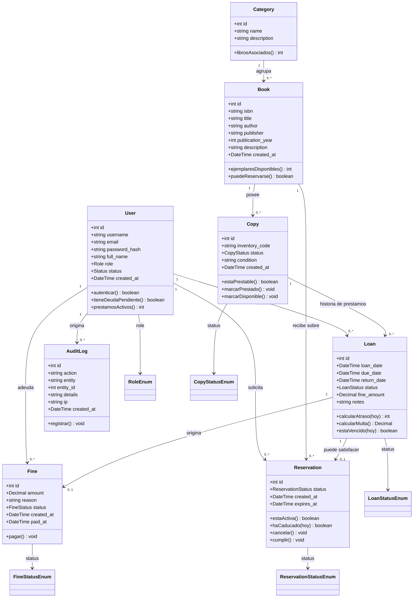
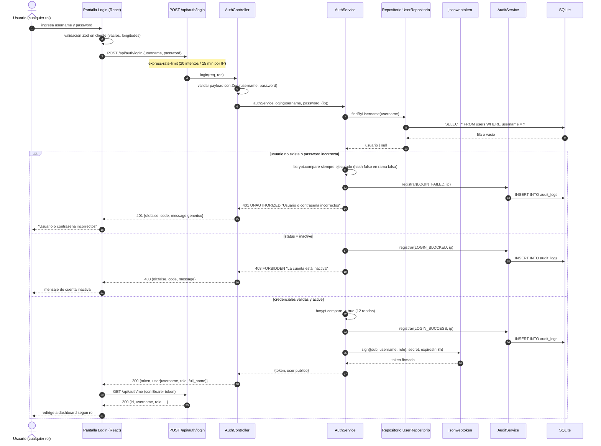
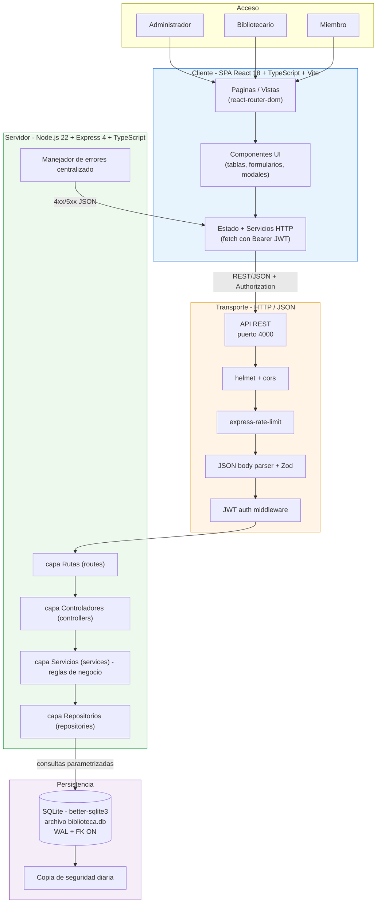
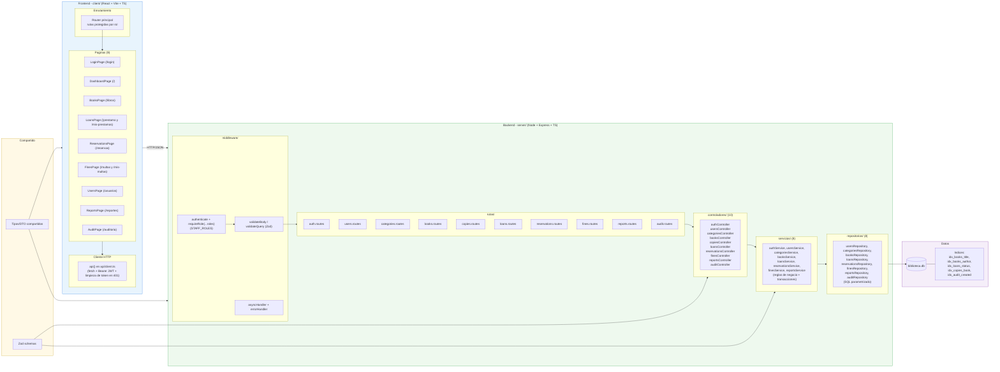

# 04 — Modelado del sistema

**Proyecto:** Sistema de Gestión de Biblioteca (SGB)
**Documento:** Diagramas de modelado en notación UML (renderizados con Mermaid) y su explicación en prosa.

> **Convención:** todos los diagramas se escriben en sintaxis Mermaid dentro de bloques ` ```mermaid `. Cada diagrama va seguido de al menos un párrafo que explica **qué representa** y **por qué se eligió** esa notación para el SGB.

---

## 1. Diagrama de casos de uso

```mermaid
usecaseDiagram
  actor "Administrador" as Admin
  actor "Bibliotecario" as Lib
  actor "Miembro" as Mem
  actor "Reloj / Sistema" as Sys

  Admin --|> Lib

  usecase "Iniciar sesion" as UC1
  usecase "Cerrar sesion" as UC2
  usecase "Gestionar usuarios" as UC3
  usecase "Gestionar categorias" as UC4
  usecase "Gestionar libros" as UC5
  usecase "Gestionar ejemplares" as UC6
  usecase "Consultar catalogo" as UC7
  usecase "Registrar prestamo" as UC8
  usecase "Registrar devolucion" as UC9
  usecase "Reservar libro" as UC10
  usecase "Cancelar reserva" as UC11
  usecase "Atender reserva" as UC12
  usecase "Pagar multa" as UC13
  usecase "Generar reportes" as UC14
  usecase "Ver auditoria" as UC15
  usecase "Caducar reservas" as UC16

  Admin --> UC1
  Admin --> UC2
  Admin --> UC3
  Admin --> UC4
  Admin --> UC5
  Admin --> UC6
  Admin --> UC7
  Admin --> UC8
  Admin --> UC9
  Admin --> UC11
  Admin --> UC12
  Admin --> UC13
  Admin --> UC14
  Admin --> UC15

  Lib --> UC1
  Lib --> UC2
  Lib --> UC4
  Lib --> UC5
  Lib --> UC6
  Lib --> UC7
  Lib --> UC8
  Lib --> UC9
  Lib --> UC11
  Lib --> UC12
  Lib --> UC13
  Lib --> UC14

  Mem --> UC1
  Mem --> UC2
  Mem --> UC7
  Mem --> UC10
  Mem --> UC11
  Mem --> UC13

  Sys --> UC16

  UC8 ..> UC9 : <<extend>>
  UC8 ..> UC13 : <<extend>>
  UC7 ..> UC10 : <<extend>>
```

### Explicación

El diagrama de casos de uso representa **quién hace qué** en el SGB desde la perspectiva del usuario, y es la notación elegida porque es el artefacto UML que mejor traduce los requisitos funcionales (RF-01…RF-55) a un lenguaje comprensible por la biblioteca sin necesidad de conocimientos técnicos. Se identifican los tres actores principales del RBAC —Administrador, Bibliotecario y Miembro—, más un actor secundario "Reloj/Sistema" que encapsula las tareas automáticas (caducidad de reservas a los 7 días, RF-43, y marcaje de préstamos atrasados al consultar, RF-35), de modo que quede explícito que esos comportamientos no dependen de una persona.

La relación de **generalización** `Admin --|> Lib` indica que el administrador hereda todos los casos de uso del bibliotecario y añade los suyos exclusivos (gestionar usuarios y ver auditoría), lo que refleja exactamente la matriz RBAC del proyecto. Las conexiones `-->` muestran la participación directa de cada actor, mientras que las relaciones `<<extend>>` modelan comportamientos opcionales: un préstamo puede extenderse en su devolución correspondiente, un préstamo puede bloquearse por deuda pendiente que conduce al pago de la multa, y la consulta del catálogo puede terminar en una reserva cuando no hay disponibilidad. Elegir casos de uso (y no otro diagrama) para esta primera visión obedece a que el documento 03 desarrolla cada uno con precondiciones, flujos alternativos y postcondiciones, y este diagrama funciona como índice visual de ese contenido.

---

## 2. Diagrama de clases



### Explicación

El diagrama de clases describe el **modelo conceptual del dominio**: las ocho entidades persistentes del SGB (users, categories, books, copies, loans, reservations, fines y audit_logs) con sus atributos exactos —tal como aparecen en el modelo de datos— y los métodos de negocio que cada una debe encapsular. Se eligió este diagrama porque el backend está organizado en capas con lógica de negocio en los servicios, y las clases del modelo reflejan directamente las tablas y las operaciones que los servicios invocan (`calcularAtraso`, `calcularMulta`, `ejemplaresDisponibles`, `haCaducado`), lo que facilita trazar cada RF a su implementación.

Las cardinalidades expresan las relaciones del esquema: un `User` realiza 0..N `Loan`; un `Category` agrupa 0..N `Book`; un `Book` posee 0..N `Copy` (relación 1-N jerárquica); un `Copy` acumula 0..N `Loan` a lo largo del tiempo; un `Loan` origina 0..1 `Fine` (solo si hay atraso) y puede satisfacer 0..1 `Reservation`. La relación `Loan → Reservation` representa el flujo de negocio por el cual una devolución pasa una reserva a `ready`. Además se modelan los **enums** de dominio (`RoleEnum`, `CopyStatusEnum`, `LoanStatusEnum`, `ReservationStatusEnum`, `FineStatusEnum`) como clases de tipo, porque en TypeScript se implementan como uniones literales y condicionan todas las transiciones de estado del sistema. Los métodos mostrados no son implementación de bajo nivel, sino el vocabulario de negocio: su presencia en el diagrama garantiza que la capa de servicios no contenga lógica duplicada ni dispersa.

---

## 3. Diagrama de secuencia — Registrar préstamo

```mermaid
sequenceDiagram
  autonumber
  actor B as Bibliotecario
  participant F as Frontend React (Vite)
  participant R as Ruta /api/loans
  participant C as Controlador LoanController
  participant S as Servicio LoanService
  participant U as Repositorio UserRepository
  participant CP as Repositorio CopyRepository
  participant L as Repositorio LoanRepository
  participant A as Servicio AuditService
  participant DB as SQLite (better-sqlite3)

  B->>F: selecciona usuario + ejemplar y confirma
  F->>F: valida atributos nativos del formulario (client)
  F->>R: POST /api/loans (copyId, memberId) + Authorization Bearer JWT
  R->>R: authenticate() + requireRole(admin|librarian)
  R->>C: validar esquema createLoanSchema (Zod)
  C->>S: loansService.create(dto, {actorId, ip})
  alt ejemplar o socio no existe
    S-->>C: 404 NOT_FOUND
  else socio inactivo
    S-->>C: 422 BUSINESS_RULE_VIOLATION
  else ejemplar no disponible o con préstamo activo
    S-->>C: 422 BUSINESS_RULE_VIOLATION
  else multa pendiente
    S->>S: consultar fines pending
    S-->>C: 422 BUSINESS_RULE_VIOLATION (monto adeudado)
  else 5 prestamos activos
    S->>L: contar activos(memberId)
    S-->>C: 422 BUSINESS_RULE_VIOLATION (límite)
  else fecha no futura
    S-->>C: 400 BAD_REQUEST
  else todas las validaciones OK
    S->>DB: BEGIN TRANSACTION
    S->>L: insertar(loan_date=hoy, due_date=hoy+14d, active)
    L->>DB: INSERT INTO loans ...
    DB-->>L: loan_id
    S->>CP: actualizarEstado(copyId, loaned)
    CP->>DB: UPDATE copies SET status='loaned'
    S->>DB: COMMIT
    S->>A: registrar(LOAN_CREATED, loans, loan_id, ip)
    A->>DB: INSERT INTO audit_logs (después del COMMIT; un fallo de auditoría no revierte el préstamo)
    S-->>C: prestamo creado
    C-->>F: 201 {id, loan_date, due_date, status, book_title}
    F-->>B: toast "Préstamo registrado - vence el DD/MM"
  end
```

### Explicación

Esta secuencia ilustra el **flujo completo de una operación transaccional crítica** del SGB: la creación de un préstamo. Se eligió este escenario porque concentra la mayor parte de las reglas de negocio (RF-23…RF-28): disponibilidad del ejemplar, estado del usuario, ausencia de deuda, límite de cinco préstamos activos y cálculo automático del plazo de 14 días. El diagrama muestra explícitamente el **recorrido por las capas** rutas → controlador → servicio → repositorios → base de datos, de modo que sirva como comprobación visual de que el backend respeta la arquitectura en capas descrita en el documento 05.

Los fragmentos `alt/else` codifican las condiciones de error que deben rechazarse con 404, 400 o 422 antes de tocar la base de datos (los códigos reales de `AppError`: `NOT_FOUND`, `BAD_REQUEST`, `BUSINESS_RULE_VIOLATION`), junto con la ruta feliz. En la rama exitosa se observa la **transacción atómica** (`BEGIN`…`COMMIT`): la inserción del préstamo y el cambio de estado del ejemplar a `loaned` se ejecutan juntos, de modo que un fallo intermedio hace `ROLLBACK` y el sistema nunca queda en un estado inconsistente (un ejemplar prestado sin préstamo); la auditoría (`LOAN_CREATED`) se escribe después del `COMMIT` y, si falla, solo se registra el error sin revertir el negocio (trazabilidad sin acoplamiento). La numeración `autonumber` facilita referenciar pasos en las pruebas de integración (casos `FC-PRE-01`…`FC-PRE-06`), y el paso final (respuesta 201 + mensaje con la fecha de vencimiento) conecta el contrato de la API con el criterio de aceptamiento RU-10 de la interfaz.

---

## 4. Diagrama de secuencia — Iniciar sesión



### Explicación

La segunda secuencia cubre el **ciclo de autenticación y autorización**, que es el requisito transversal RS-01…RS-03 del proyecto. Se eligió el login porque concentra las decisiones de seguridad más importantes del SGB: validación de entrada con Zod, verificación del hash bcrypt de 12 rondas (que justifica el límite de 2 segundos de RNF-05), bloqueo de usuarios con `status='inactive'` (RF-03), emisión del JWT con expiración de 8 horas (RS-08) y registro de auditoría tanto en el éxito como en el fracaso (RF-05), además del *rate limiting* de 20 intentos por 15 minutos por IP aplicado antes de llegar al controlador (RS-07).

El diagrama deja ver dos decisiones deliberadas de diseño. Primero, la **respuesta genérica** en la rama de credenciales inválidas: el sistema no distingue entre "usuario inexistente" y "contraseña incorrecta" (el mismo mensaje `UNAUTHORIZED` y el `bcrypt.compare` siempre ejecutado), evitando que un atacante enumere cuentas, mientras que el caso del usuario inactivo sí tiene mensaje propio (`FORBIDDEN`) porque es una condición que el propio usuario debe conocer. Segundo, el **doble paso** posterior al login: el frontend recibe el token y acto seguido llama a `GET /api/auth/me` para reconstruir el estado de sesión, de manera que la sesión en el cliente siempre se deriva del servidor y nunca de datos confiados localmente. Al igual que en la secuencia anterior, cada interacción está etiquetada con el método HTTP y el repositorio implicado, lo que permite traducir el diagrama directamente en los casos de prueba de integración `FC-AU-01`…`FC-AU-12`.

---

## 5. Diagrama de arquitectura (visión general)



### Explicación

Este diagrama de arquitectura presenta la **visión general de despliegue lógico** del SGB: un cliente SPA React separado del servidor, comunicados exclusivamente por una API REST/JSON. Se eligió un diagrama de bloques con subgrafos porque el problema de la biblioteca es, en esencia, de centralización de la información, y el artefacto debe hacer visible de un vistazo las tres fronteras del sistema: (1) el navegador donde opera el frontend, (2) la capa HTTP con sus middlewares de seguridad y (3) el servidor Express organizado en capas que finalmente habla con SQLite.

La lectura del diagrama es secuencial y corresponde exactamente al ciclo de vida de una petición: los tres roles de usuario (admin, librarian, member) usan las mismas páginas del cliente, que añaden el `Authorization: Bearer` al invocar la API; el tráfico atraviesa `helmet`+`cors`, el limitador de tasa, el parseo del cuerpo y la validación Zod, y recién entonces el middleware JWT decide si continúa hacia las rutas. Dentro del backend se distinguen las cuatro capas (rutas → controladores → servicios → repositorios) más un **manejador de errores centralizado** que devuelve JSON normalizado al cliente. La caja de persistencia muestra el archivo SQLite en modo WAL con integridad referencial activa y su copia de seguridad diaria, recordando que la durabilidad (RNF-08/RD-03) es una responsabilidad explícita del diseño y no una característica accidental.

---

## 6. Diagrama de componentes / módulos



### Explicación

El diagrama de componentes desglosa el sistema en **módulos físicos de código**: las carpetas y archivos concretos que conforman el frontend (`pages/`, `api/`, `components/`, `context/`, enrutamiento) y el backend (`modules/*/routes|controller|service|repository`, `middleware/`), además de los artefactos compartidos (tipos del contrato) y los índices de la base de datos. Se eligió este diagrama complementario al de arquitectura porque, mientras el anterior explica *cómo se comunica el sistema con el exterior*, este explica *cómo está organizado internamente el código*, que es lo que un desarrollador necesita para ubicar dónde implementar cada requisito.

La lectura clave es la **asimetría de dependencias**: en el frontend, el enrutamiento delega en las páginas y éstas en un único cliente HTTP (`api/client.ts`) que centraliza la inyección del token; en el backend, la flecha única `rutas → controladores → servicios → repositorios` hace explícito que ninguna capa puede saltarse a otra (los repositorios jamás invocan controladores, y los controladores no escriben SQL). Los middlewares se muestran como una pila previa a las rutas (`authenticate → requireRole → validateBody/validateQuery → handler`) porque representan el orden real de ejecución en Express. Los esquemas Zod viven en el servidor (el cliente usa atributos nativos de formulario) y los tipos del contrato se conectan a ambas orillas para indicar que el **contrato de la API** es lo único que acopla cliente y servidor, lo que permite evolucionarlos de forma independiente. Por último, los índices se listan junto a SQLite porque son la palanca de rendimiento concreta detrás de RR-01 y RR-05.
