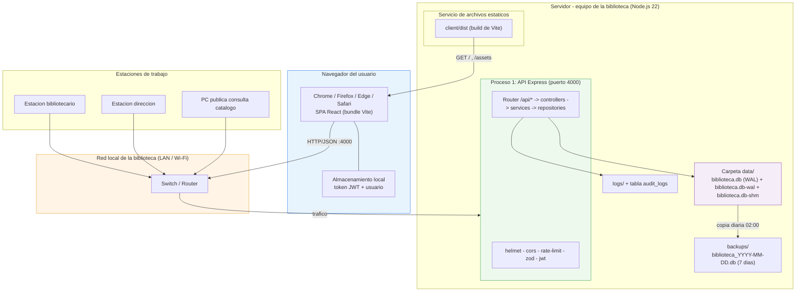

# 05 — Arquitectura de software

**Proyecto:** Sistema de Gestión de Biblioteca (SGB)
**Documento:** Justificación de la arquitectura, descripción de capas, flujo de una petición, despliegue y decisiones de diseño.

---

## 1. Arquitectura seleccionada

El SGB adopta una **arquitectura cliente-servidor en capas (layered architecture)** con el patrón **MVC** (Modelo–Vista–Controlador) en el backend y una **SPA** (Single Page Application) como vista en el frontend:

```
Frontend React (Vista MVC)  ⇄  API REST/JSON  ⇄  Backend Express (Controlador + Servicio + Modelo)  ⇄  SQLite
```

**Definición operativa:** una arquitectura en capas agrupa el software en niveles horizontales donde cada nivel solo puede invocar al inmediatamente inferior, y el MVC separa la presentación (Vista), la coordinación de la petición (Controlador) y las reglas de negocio + persistencia (Modelo/Servicio/Repositorio).

### 1.1 Elementos del MVC en el SGB

| Elemento MVC | Dónde vive en el SGB | Responsabilidad |
|---|---|---|
| **Vista** | `client/` — páginas React + componentes | Renderizar, validar en cliente, mostrar errores e indicadores de carga. |
| **Controlador** | `server/` — `controllers/*` | Recibir la petición HTTP, ejecutar validación Zod, invocar al servicio y traducir su resultado a código HTTP/JSON. |
| **Modelo** | `server/` — `services/*` + `repositories/*` + tablas SQLite | Reglas de negocio (loan, multa, reserva) y persistencia. |
| **Enrutador (Vista→Controlador)** | `server/` — `src/modules/*/routes.ts` | Mapear método+URL al controlador y encadenar `authenticate`/`requireRole`/`validateBody`/`validateQuery`. |

---

## 2. Justificación de la elección

### 2.1 Por qué arquitectura en capas

1. **El dominio es transaccional y secuencial.** Registrar un préstamo implica validar usuario → validar ejemplar → validar límite → escribir préstamo → cambiar ejemplar → auditar. Ese flujo lineal encaja naturalmente en capas y hace trivial el manejo de transacciones (documentado en la secuencia del préstamo).
2. **Equipo de desarrollo de una sola persona.** El trabajo es individual; una estructura convencional de carpetas (rutas, controllers, services, repositories) reduce el *cognitive load* y evita decisiones de arquitectura innecesarias en cada módulo.
3. **Testeabilidad.** Con inyección simple en los servicios, Vitest puede probar la lógica de negocio sin HTTP (unitarias) y con supertest (integración), cumpliendo RNF-10.
4. **Cambio localizado.** Cambiar la política de multas o el plazo de préstamo se hace en un único servicio, sin tocar rutas ni frontend.
5. **Seguridad perimetral consistente.** Los middlewares (helmet, rate limit, Zod, JWT, RBAC) se aplican una sola vez por ruta y protegen toda la capa de controladores.
6. **Requisito de despliegue simple.** Basta un proceso Node sirviendo API y el build estático del frontend, sin orquestadores ni servicios adicionales.

### 2.2 Por qué MVC

- **Separación de responsabilidades verificable:** la vista React nunca conoce SQL; los repositorios nunca conocen Express; los controladores nunca contienen reglas de negocio.
- **Reutilización de la vista:** la misma API REST podría atender, en el futuro, una app móvil sin duplicar lógica.
- **Alineación con los requisitos de la asignatura:** el patrón se evidencia en el diagrama de componentes y en cada caso de prueba de integración.

---

## 3. Por qué **NO** microservicios (arquitectura descartada)

| Criterio | SGB (alcance real) | Microservicios | Conclusión |
|---|---|---|---|
| Dominio | Un único dominio cohesionado (préstamos) | Múltiples dominios independientes | Un solo módulo no justifica partirlo |
| Escala esperada | ~3.000 usuarios, decenas concurrentes | Miles de TPS, equipos grandes | SQLite + un proceso bastan (RNF-04: 50 concurrentes) |
| Transaccionalidad | Préstamo + ejemplar + auditoría en una misma transacción ACID | Compensaciones sagas, dos fases | La transacción local simplifica enormemente la integridad |
| Equipo | 1 desarrollador | Varios equipos/áreas | Más servicios = más coordinación que capacidad |
| Despliegue | 1 proceso Node en equipo local | Contenedores, orquestador, service mesh | Infraestructura desproporcionada |
| Observabilidad | Logs + audit_logs | Tracing distribuido, correlación de IDs | Costo injustificado |
| Consistencia de datos | 3FN en una sola BD | Consistencia eventual entre BD | La biblioteca exige fuente única de verdad |
| Costo operativo | Cero licencias, hardware existente | Múltiples servicios en ejecución | Presupuesto municipal limitado |

**Decisión:** se descartan microservicios, buses de eventos (Kafka/RabbitMQ), GraphQL y BFF porque **el costo y la complejidad superan el beneficio** para el alcance de un trabajo final individual con una única fuente de datos. Se deja explícito en el análisis que la arquitectura en capas **permite evolucionar** hacia microservicios (extrayendo reservas o reportes como servicio) sin reescribir el dominio, gracias a que los servicios encapsulan las reglas de negocio tras interfaces claras.

---

## 4. Capas descritas

### 4.1 Capa de presentación (frontend)

| Elemento | Tecnología | Responsabilidad |
|---|---|---|
| Páginas | React 18 + TS | 11 pantallas (doc. 07) |
| Enrutamiento | react-router-dom | Rutas protegidas y guardas por rol |
| Cliente HTTP | `fetch` envuelto | Adjunta `Authorization`, centraliza manejo 401/403 |
| Validación espejo | esquemas Zod compartidos | Feedback inmediato sin round-trip (RU-03) |

### 4.2 Capa de transporte / API

- Protocolo **HTTP/1.1 + JSON**, prefijo `/api`.
- Middlewares globales en orden: `helmet` → `cors` (lista blanca) → `express.json({ limit: '1mb' })` → `clientIp` → `express-rate-limit` (500/15 min) → rutas. Por ruta: `authenticate` → `requireRole(...)` → `validateBody(schema)`/`validateQuery(schema)` → controlador.
- Errores normalizados: `{ "ok": false, "code": "BUSINESS_RULE_VIOLATION", "message": "…" }` con códigos 400/401/403/404/409/422/429/500 (`BAD_REQUEST`, `INVALID_TOKEN`, `UNAUTHORIZED`, `FORBIDDEN`, `NOT_FOUND`, `CONFLICT`, `BUSINESS_RULE_VIOLATION`, `CONSTRAINT_VIOLATION`, `RATE_LIMITED`, `ROUTE_NOT_FOUND`, `INTERNAL_ERROR`; `VALIDATION_ERROR` queda como rama defensiva de `ZodError` sin pasar por el validador).

### 4.3 Capa de presentación del servidor: **Rutas**

Mapean `método + path` → controlador y declaran autorizaciones. **39 rutas de recursos + `GET /api/health` = 40 endpoints** (matriz completa en doc. 08, §3):

| Grupo | Rutas | Autorización |
|---|---|---|
| Salud | `GET /api/health` | público |
| Auth | `POST /api/auth/login`, `POST /api/auth/register`, `GET /api/auth/me` | login público + rate limit; register → `requireRole('admin')`; me → `authenticate` |
| Usuarios | `GET /api/users`, `GET /api/users/:id`, `POST /api/users`, `PUT/DELETE /api/users/:id` | `authenticate` en todo el router; rol por ruta (`listUsersGuard` para el listado, `requireRole('admin')` en el resto) |
| Categorías | `GET /api/categories`, `GET /api/categories/:id`, `POST`, `PUT /:id`, `DELETE /:id` | lectura → `authenticate`; escritura → `requireRole(...STAFF_ROLES)`; DELETE → `requireRole('admin')` |
| Libros | `GET /api/books` (`search`, `categoryId`, `available`, `page`, `pageSize`), `GET /api/books/:id`, `POST`, `PUT /:id`, `DELETE /:id`, `GET/POST /api/books/:id/copies` | lectura → `authenticate`; crear/editar → `STAFF_ROLES`; DELETE → `admin` |
| Ejemplares | `PUT /api/copies/:id`, `DELETE /api/copies/:id` | PUT → `STAFF_ROLES`; DELETE → `admin` |
| Préstamos | `POST /api/loans`, `POST /api/loans/:id/return`, `GET /api/loans`, `GET /api/loans/:id`, `GET /api/loans/my` | escritura → `STAFF_ROLES`; lectura → `authenticate` (los `member` ven solo lo propio) |
| Reservas | `POST /api/reservations`, `GET /api/reservations`, `GET /api/reservations/my`, `POST /api/reservations/:id/cancel`, `POST /api/reservations/:id/fulfill` | creación/cancelación → `authenticate` + propiedad; listado → `authenticate` (propias en `member`); fulfill → `STAFF_ROLES` |
| Multas | `GET /api/fines`, `GET /api/fines/my`, `POST /api/fines/:id/pay` | global → `STAFF_ROLES`; `my`/`pay` → `authenticate` + propiedad |
| Reportes | `GET /api/reports/summary`, `GET /api/reports/top-books`, `GET /api/reports/overdue` | `router.use(authenticate, requireRole(...STAFF_ROLES))` |
| Auditoría | `GET /api/audit` | `router.use(authenticate, requireRole('admin'))` |

### 4.4 Capa de controladores

- Extraen `req.body/params/query`, ejecutan `validateBody`/`validateQuery` con Zod, llaman **una sola vez** al servicio y devuelven la respuesta.
- **No** contienen reglas de negocio ni SQL; su complejidad máxima es la traducción HTTP y, en su caso, la comprobación de **propiedad** del recurso (ej. `GET /api/loans/:id` para `member`).
- Devuelven códigos estándar: 200 (consulta), 201 (creación), 200 con `data.mode` en el borrado, 4xx (regla/validación), 500 (error no previsto).

### 4.5 Capa de servicios (corazón del MVC)

| Servicio | Reglas de negocio que implementa |
|---|---|
| `AuthService` | bcrypt 12 rondas, emisión/validación JWT, bloqueo de `inactive`, auditoría de login. |
| `UserService` | unicidad de username/email, creación solo por admin, borrado lógico (RF-06…RF-12). |
| `CategoryService` / `BookService` | unicidad de nombre/ISBN, bloqueo de borrado con dependencias (RF-13…RF-19). |
| `CopyService` | transiciones de estado del ejemplar y código de inventario único (RF-20…RF-22). |
| `LoanService` | plazo 14 días, disponibilidad, límite 5, bloqueo por deuda, cálculo de atraso y multa 0,50/día, activación de reservas (RF-23…RF-36). |
| `ReservationService` | disponibilidad total del libro, límite 3, caducidad 7 días, cancelación/fulfill (RF-37…RF-43). |
| `FineService` | ciclo `pending→paid`, impago doble, desbloqueo de deudores (RF-44…RF-48). |
| `ReportService` | agregaciones de resumen, ranking y atrasos (RF-49…RF-52). |
| `AuditService` | escritura *append-only* en `audit_logs` (RF-53…RF-55). |

Los servicios son los únicos que conocen **múltiples** repositorios y abren **transacciones**, de modo que la atomicidad es una responsabilidad de esta capa y no del controlador.

### 4.6 Capa de repositorios

- Encapsulan todo el SQL con **consultas parametrizadas** (`?` bindings) vía better-sqlite3 (síncrono, de alto rendimiento en SQLite).
- Exponen un API orientado a dominio: `buscarPorUsername`, `contarActivosPorUsuario`, `buscarLibrosConFiltros`, `insertarPrestamo`, etc.
- No contienen lógica de negocio; únicamente traducen entidades a filas y viceversa.

### 4.7 Capa de datos

- **SQLite** en archivo con `PRAGMA foreign_keys = ON`, `journal_mode = WAL` y `busy_timeout`.
- Índices reales (16 en total sobre 6 de las 8 tablas): `idx_books_title`, `idx_books_author`, `idx_books_category`, `idx_copies_book`, `idx_copies_status`, `idx_loans_user`, `idx_loans_copy`, `idx_loans_status`, `idx_loans_due`, `idx_reservations_book`, `idx_reservations_user`, `idx_fines_user`, `idx_fines_status`, `idx_audit_user`, `idx_audit_created` + el índice **único parcial** `uq_reservations_active` (lista completa en doc. 06, §4). `users` y `categories` no llevan índices propios: sus consultas son por UNIQUE (`username`, `email`, `name`) o por pocos registros.
- Copias de seguridad diarias (ver doc. 08).

---

## 5. Flujo de una petición (ejemplo real: `POST /api/loans`)

| Paso | Capa | Qué ocurre | Posible salida |
|---|---|---|---|
| 1 | Red / proxy | El navegador envía `POST /api/loans` con `Authorization: Bearer <jwt>` y JSON | — |
| 2 | `helmet` | Fija cabeceras de seguridad y CSP | — |
| 3 | `cors` | Valida el origen contra la lista blanca | 403 CORS si no coincide |
| 4 | `express-rate-limit` | Cuenta la petición por IP | 429 al superar 500/15 min |
| 5 | `express.json()` | Parsea el cuerpo (límite 1 MB) | 400 si el JSON está mal formado |
| 6 | `authenticate` | Verifica firma y expiración del JWT (8 h) | 401 `INVALID_TOKEN` sin token / inválido / expirado |
| 7 | `requireRole(...STAFF_ROLES)` | Compara `req.user.role` con `['admin','librarian']` | 403 `FORBIDDEN` si el rol no calza |
| 8 | `validateBody(createLoanSchema)` | Valida `copyId`, `memberId` (y `dueDate`, `notes`) con Zod | 400 `BAD_REQUEST` con `details` por campo |
| 9 | `loansController.create` | Traduce HTTP y delega | — |
| 10 | `loansService.create` | Consulta ejemplar, socio, multas y préstamos activos; aplica RF-24…RF-31 | 422 `BUSINESS_RULE_VIOLATION` / 404 / 400 |
| 11 | Transacción | `BEGIN` → `INSERT loans` → `UPDATE copies` → `COMMIT` | `ROLLBACK` + 500 en cualquier fallo |
| 12 | Auditoría | `audit()` inserta `LOAN_CREATED` **después** del `COMMIT` (si falla, solo se loguea el error y el préstamo persiste) | — |
| 13 | Repositorios | Ejecutan SQL parametrizado | — |
| 13 | Controlador | Devuelve `201` con el préstamo (`status`, `due_date`, `book_title`…) | — |
| 14 | Cliente | Actualiza estado y muestra el aviso con la fecha de vencimiento | — |
| 15 | `errorHandler` | Captura cualquier error no manejado y lo normaliza sin exponer stack trace | 500 genérico |

---

## 6. Diagrama de despliegue



### Explicación del diagrama de despliegue

El diagrama muestra el **despliegue real en la Biblioteca "Ricardo Gómez"**: un único equipo servidor ejecuta el proceso Node 22 —que expone la API en el puerto 4000 y, en desarrollo, el bundle estático de Vite (`client/dist`) se sirve en el 5173 con proxy hacia la API—, el archivo de base de datos `biblioteca.db` con sus archivos WAL, la carpeta de copias de seguridad y el registro de auditoría. Los usuarios no instalan nada: cualquier navegador de las estaciones de trabajo (bibliotecario, dirección, PC de consulta pública) o de la red de la biblioteca accede por HTTP sobre la LAN.

Se eligió este diagrama porque responde la pregunta operativa **"¿dónde corre y cómo se accede?"**: no hay CDN, ni contenedores, ni servicios cloud, coherente con la decisión descartada de microservicios y con la exigencia de operar sin dependencias externas (RD-06). La separación entre proceso API y archivos estáticos dentro del mismo host permite que la copia de seguridad diaria se ejecute con un simple comando sobre el archivo mientras el servidor sigue operando en modo WAL. El corte de red o de energía se mitiga con el modo WAL (RD-07) y con la restauración en ≤ 15 minutos (RD-04).

---

## 7. Decisiones de arquitectura y alternativas descartadas

| # | Decisión (ADR breve) | Contexto | Alternativas descartadas y por qué |
|---|---|---|---|
| AD-1 | SPA React + API REST separada (client–server) | Se requiere consulta en sitio y operación en mostrador | **Server-side rendering / PHP tradicional:** acopla presentación y datos, dificulta RBAC en cliente y pruebas E2E. **Monolito con plantillas:** menos reutilizable y menos alineado con el objetivo de enseñar API REST. |
| AD-2 | Arquitectura en capas con MVC en backend | Reglas de negocio transaccionales | **Capa única (scripts):** inviable para 55 RF y pruebas. **Hexagonal/ports-adapters:** más ceremonia de la necesaria para un proyecto individual, aunque compatible a futuro. |
| AD-3 | Un solo proceso Node + SQLite | ~3.000 usuarios, decenas concurrentes, hardware local | **Microservicios:** coste operativo y consistencia eventual innecesarios (§3). **MongoDB/PostgreSQL:** exigen instalación y administración de servidor de BD; SQLite cumple RNF-07/08 con cero configuración. **MySQL:** licencia/servicio adicional sin beneficio. |
| AD-4 | better-sqlite3 (síncrono) sobre driver asincrónico | SQLite local, operación por transacciones cortas | **Prisma/ORM completo:** añade capas y learning curve; los repositorios ya encapsulan el SQL. **sqlite3 (async):** callbacks anidados sin necesidad, ya que SQLite local es instantáneo. |
| AD-5 | JWT stateless de 8 h + refresh manual | Sesión simple, sin servidor de sesiones | **Sesiones en servidor (cookies):** requiere tabla de sesiones y no escala con SPA. **Refresh token rotativo completo:** más complejidad de la justificable; se cubre con expiración corta y re-login (RS-08). |
| AD-6 | Validación Zod compartida cliente/servidor | Mismo contrato en ambos lados | **Solo validación en cliente:** inseguro. **Joi/express-validator:** válido, pero Zod da tipos TypeScript inferidos sin duplicación. |
| AD-7 | Borrado lógico de usuarios (`status='inactive'`) | Debe conservarse el histórico de préstamos y auditoría | **Borrado físico:** rompería FK y el histórico (RNF-07). |
| AD-8 | Transacciones en la capa de servicios | Operaciones multi-tabla (loan+copy+audit) | **Sin transacción:** riesgo de ejemplar `loaned` sin préstamo. **Unit of Work generalizado:** sobre-ingeniería para 8 tablas. |
| AD-9 | Auditoría append-only en tabla propia | Control interno municipal | **Solo logs de archivo:** no consultable desde la UI ni con IP/usuario. **Trigger de BD:** menos explícito y difícil de probar. |
| AD-10 | Commits convencionales en `main` | Proyecto individual | **Git Flow completo (develop/release):** burocrático para un solo autor; se reserva para fases futuras. |

---

## 8. Matriz de calidad asociada a la arquitectura

| Atributo | Cómo lo sostiene la arquitectura |
|---|---|
| Seguridad | Middlewares en una sola pila + RBAC por ruta + Zod + bcrypt + JWT + auditoría. |
| Mantenibilidad | Carpetas por capa, reglas de negocio centralizadas en servicios, TypeScript estricto. |
| Rendimiento | better-sqlite3 síncrono + índices + paginación obligatoria (RR-08). |
| Confiabilidad | Transacciones, WAL, backup diario y manejo de errores centralizado. |
| Escalabilidad | Índices en BD, paginación y posibilidad de escalar verticalmente; extracción futura de reportes a un servicio. |
| Usabilidad | SPA con respuestas inmediatas, validación espejo y guardas por rol. |
