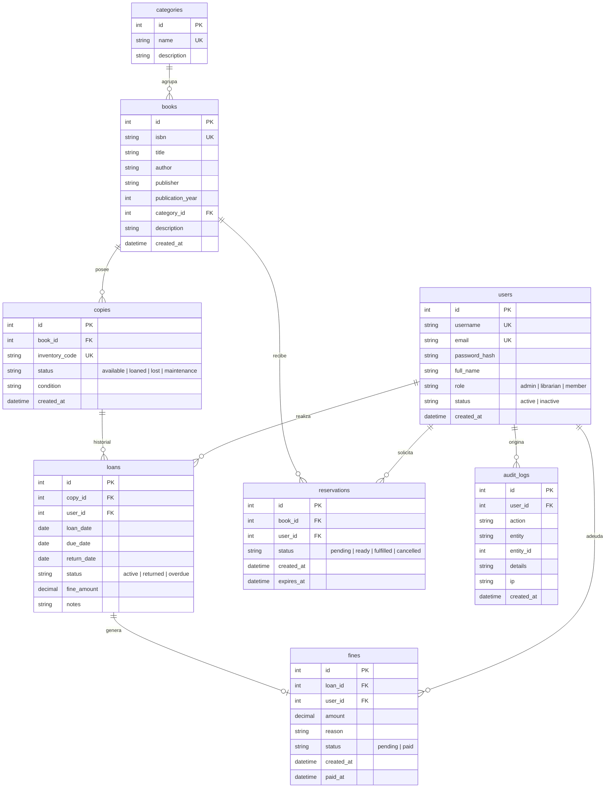

# 06 — Base de datos

**Proyecto:** Sistema de Gestión de Biblioteca (SGB)
**Documento:** Entidades, atributos, relaciones, diagrama entidad-relación, script DDL, justificación de 3FN y políticas de integridad.

**Motor:** SQLite (better-sqlite3), archivo `biblioteca.db`, `PRAGMA foreign_keys = ON`, `journal_mode = WAL`.

---

## 1. Inventario de entidades

### 1.1 `users` — Usuarios del sistema

| Atributo | Tipo | Restricción | Rol en la entidad |
|---|---|---|---|
| `id` | INTEGER | **PK**, `AUTOINCREMENT` | Identificador |
| `username` | TEXT | **UNIQUE**, NOT NULL, 3–30 | Credencial de acceso |
| `email` | TEXT | **UNIQUE**, NOT NULL | Contacto |
| `password_hash` | TEXT | NOT NULL | Hash bcrypt (12 rondas), nunca texto plano |
| `full_name` | TEXT | NOT NULL | Nombre completo |
| `role` | TEXT | NOT NULL, CHECK ∈ {admin, librarian, member} | RBAC |
| `status` | TEXT | NOT NULL, CHECK ∈ {active, inactive} | Borrado lógico / bloqueo |
| `created_at` | TEXT/DATETIME | NOT NULL, DEFAULT CURRENT_TIMESTAMP | Alta |

### 1.2 `categories` — Categorías temáticas

| Atributo | Tipo | Restricción |
|---|---|---|
| `id` | INTEGER | **PK**, `AUTOINCREMENT` |
| `name` | TEXT | **UNIQUE**, NOT NULL |
| `description` | TEXT | NULL permitido |

### 1.3 `books` — Obras del catálogo

| Atributo | Tipo | Restricción |
|---|---|---|
| `id` | INTEGER | **PK**, `AUTOINCREMENT` |
| `isbn` | TEXT | **UNIQUE**, NOT NULL |
| `title` | TEXT | NOT NULL |
| `author` | TEXT | NOT NULL |
| `publisher` | TEXT | NULL |
| `publication_year` | INTEGER | CHECK entre 1400 y año actual |
| `category_id` | INTEGER | **FK → categories(id)**, NOT NULL |
| `description` | TEXT | NULL |
| `created_at` | DATETIME | NOT NULL, DEFAULT CURRENT_TIMESTAMP |

### 1.4 `copies` — Ejemplares físicos

| Atributo | Tipo | Restricción |
|---|---|---|
| `id` | INTEGER | **PK**, `AUTOINCREMENT` |
| `book_id` | INTEGER | **FK → books(id)**, NOT NULL |
| `inventory_code` | TEXT | **UNIQUE**, NOT NULL |
| `status` | TEXT | CHECK ∈ {available, loaned, lost, maintenance}, DEFAULT 'available' |
| `condition` | TEXT | ej. Nueva/Buena/Regular/Dañada |
| `created_at` | DATETIME | NOT NULL, DEFAULT CURRENT_TIMESTAMP |

### 1.5 `loans` — Préstamos

| Atributo | Tipo | Restricción |
|---|---|---|
| `id` | INTEGER | **PK**, `AUTOINCREMENT` |
| `copy_id` | INTEGER | **FK → copies(id)**, NOT NULL |
| `user_id` | INTEGER | **FK → users(id)**, NOT NULL |
| `loan_date` | DATE | NOT NULL, DEFAULT CURRENT_DATE |
| `due_date` | DATE | NOT NULL (loan_date + 14) |
| `return_date` | DATE | NULL (pendiente de devolución) |
| `status` | TEXT | CHECK ∈ {active, returned, overdue}, DEFAULT 'active' |
| `fine_amount` | NUMERIC | DEFAULT 0, CHECK ≥ 0 |
| `notes` | TEXT | NULL |

### 1.6 `reservations` — Reservas

| Atributo | Tipo | Restricción |
|---|---|---|
| `id` | INTEGER | **PK**, `AUTOINCREMENT` |
| `book_id` | INTEGER | **FK → books(id)**, NOT NULL |
| `user_id` | INTEGER | **FK → users(id)**, NOT NULL |
| `status` | TEXT | CHECK ∈ {pending, ready, fulfilled, cancelled}, DEFAULT 'pending' |
| `created_at` | DATETIME | NOT NULL, DEFAULT CURRENT_TIMESTAMP |
| `expires_at` | DATETIME | NOT NULL (created_at + 7 días) |

### 1.7 `fines` — Multas

| Atributo | Tipo | Restricción |
|---|---|---|
| `id` | INTEGER | **PK**, `AUTOINCREMENT` |
| `loan_id` | INTEGER | **FK → loans(id)**, NOT NULL |
| `user_id` | INTEGER | **FK → users(id)**, NOT NULL |
| `amount` | NUMERIC | NOT NULL, CHECK > 0 (0,50/día) |
| `reason` | TEXT | NOT NULL |
| `status` | TEXT | CHECK ∈ {pending, paid}, DEFAULT 'pending' |
| `created_at` | DATETIME | NOT NULL, DEFAULT CURRENT_TIMESTAMP |
| `paid_at` | DATETIME | NULL |

### 1.8 `audit_logs` — Bitácora (append-only)

| Atributo | Tipo | Restricción |
|---|---|---|
| `id` | INTEGER | **PK**, `AUTOINCREMENT` |
| `user_id` | INTEGER | **FK → users(id)** (NULL para intentos de login fallidos con usuario desconocido) |
| `action` | TEXT | NOT NULL, ej. `LOGIN_SUCCESS`, `LOAN_CREATED` |
| `entity` | TEXT | NOT NULL, ej. `loans`, `users` |
| `entity_id` | INTEGER | NULL permitido |
| `details` | TEXT | JSON/resumen legible |
| `ip` | TEXT | IP del cliente |
| `created_at` | DATETIME | NOT NULL, DEFAULT CURRENT_TIMESTAMP |

---

## 2. Relaciones

| # | Relación | Tipo (en el dominio) | Cardinalidad | FK | Justificación |
|---|---|---|---|---|---|
| R1 | users → loans | Un usuario realiza muchos préstamos | **1–N** | `loans.user_id` | Cada préstamo pertenece a un solo usuario |
| R2 | users → reservations | Un usuario solicita muchas reservas | **1–N** | `reservations.user_id` | — |
| R3 | users → fines | Un usuario adeuda muchas multas | **1–N** | `fines.user_id` | Se duplica el dato para cobrar por usuario aun si el préstamo se archiva |
| R4 | users → audit_logs | Un usuario origina muchos eventos | **1–N** | `audit_logs.user_id` | — |
| R5 | categories → books | Una categoría agrupa muchos libros | **1–N** | `books.category_id` | Un libro tiene **una** categoría (normalización: evita columna multivaluada) |
| R6 | books → copies | Un libro posee muchos ejemplares | **1–N** | `copies.book_id` | El ejemplar es la unidad física prestable |
| R7 | books → reservations | Un libro acumula reservas | **1–N** | `reservations.book_id` | La reserva es sobre el **título**, no sobre una copia |
| R8 | copies → loans | Un ejemplar acumula préstamos en el tiempo | **1–N** | `loans.copy_id` | Histórico de circulación |
| R9 | loans → fines | Un préstamo origina 0..1 multa | **1–0..1** | `fines.loan_id` | Solo si hubo atraso (máximo una multa por préstamo en esta versión) |
| R10 | loans → reservations | Un préstamo puede satisfacer una reserva | **1–0..1** (lógica, sin FK) | — | Se resuelve en el servicio al pasar la reserva a `ready` |
| R11 | books ⇄ categories *n–m* (hypotética) | — | **N–M** | — | **No aplica**: un libro tiene una sola categoría; si en el futuro se requirieran múltiples etiquetas, se crearía la tabla puente `book_tags`. Se documenta para dejar constancia de que se evaluó. |

**Nota sobre N-M:** en el SGB las relaciones N–M se modelaron de forma **descompuesta en 1–N** mediante la clave foránea correspondiente (por ejemplo, `loans` actúa como tabla asociativa entre `copies` y `users` y además almacena atributos propios del evento: fechas, estado y multa; `reservations` hace lo propio entre `books` y `users`). Esta es la razón por la que no existe una tabla puente explícita.

---

## 3. Diagrama entidad-relación



### Explicación del diagrama ER

El diagrama representa las ocho entidades persistentes del SGB con sus atributos, claves primarias (`PK`), claves foráneas (`FK`) y restricciones de unicidad (`UK`), más las cardinalidades: todas las relaciones son **uno-a-muchos** marcadas con `||--o{`, donde el lado "muchos" siempre porta la FK. La única relación con participación obligatoria parcial es `loans ||--o| fines` (un préstamo genera **como máximo una** multa), lo que se traduce en que `fines.loan_id` pueda referenciar un préstamo pero no todo préstamo tenga multa.

Se eligió la notación ER (y no un diagrama de clases) para este documento porque su propósito es **el diseño físico de la base de datos**: sirve de puente directo entre el modelo de dominio del documento 04 y el script DDL de la sección 4. Nótese que `reservations` se asocia a `books` (título) y no a `copies`, lo que materializa la regla de negocio "la reserva es sobre el libro cuando **todos** sus ejemplares están prestados"; y que `audit_logs` referencia a `users` de forma anulable para poder registrar intentos de login fallidos de usuarios desconocidos o inactivos sin perder la bitácora.

---

## 4. Script DDL completo

```sql
-- =====================================================================
-- Sistema de Gestion de Biblioteca (SGB)
-- Base de datos: SQLite (better-sqlite3)
-- Script DDL completo - version 1.0
-- Ejecutar con: sqlite3 biblioteca.db < 00_schema.sql
-- =====================================================================

PRAGMA foreign_keys = ON;
PRAGMA journal_mode = WAL;

-- ---------------------------------------------------------------------
-- 1. users
-- ---------------------------------------------------------------------
CREATE TABLE IF NOT EXISTS users (
  id            INTEGER PRIMARY KEY AUTOINCREMENT,
  username      TEXT    NOT NULL UNIQUE,
  email         TEXT    NOT NULL UNIQUE,
  password_hash TEXT    NOT NULL,
  full_name     TEXT    NOT NULL,
  role          TEXT    NOT NULL CHECK (role IN ('admin', 'librarian', 'member')),
  status        TEXT    NOT NULL DEFAULT 'active'
                        CHECK (status IN ('active', 'inactive')),
  created_at    TEXT    NOT NULL DEFAULT (datetime('now', 'localtime'))
);

-- ---------------------------------------------------------------------
-- 2. categories
-- ---------------------------------------------------------------------
CREATE TABLE IF NOT EXISTS categories (
  id          INTEGER PRIMARY KEY AUTOINCREMENT,
  name        TEXT    NOT NULL UNIQUE,
  description TEXT
);

-- ---------------------------------------------------------------------
-- 3. books
-- ---------------------------------------------------------------------
CREATE TABLE IF NOT EXISTS books (
  id              INTEGER PRIMARY KEY AUTOINCREMENT,
  isbn            TEXT    NOT NULL UNIQUE,
  title           TEXT    NOT NULL,
  author          TEXT    NOT NULL,
  publisher       TEXT,
  publication_year INTEGER CHECK (publication_year BETWEEN 1400
                          AND CAST(strftime('%Y', 'now') AS INTEGER)),
  category_id     INTEGER NOT NULL,
  description     TEXT,
  created_at      TEXT    NOT NULL DEFAULT (datetime('now', 'localtime')),
  CONSTRAINT fk_books_category
    FOREIGN KEY (category_id) REFERENCES categories (id)
    ON UPDATE CASCADE ON DELETE RESTRICT
);

-- ---------------------------------------------------------------------
-- 4. copies
-- ---------------------------------------------------------------------
CREATE TABLE IF NOT EXISTS copies (
  id             INTEGER PRIMARY KEY AUTOINCREMENT,
  book_id        INTEGER NOT NULL,
  inventory_code TEXT    NOT NULL UNIQUE,
  status         TEXT    NOT NULL DEFAULT 'available'
                         CHECK (status IN ('available', 'loaned', 'lost', 'maintenance')),
  condition      TEXT    NOT NULL DEFAULT 'Buena',
  created_at     TEXT    NOT NULL DEFAULT (datetime('now', 'localtime')),
  CONSTRAINT fk_copies_book
    FOREIGN KEY (book_id) REFERENCES books (id)
    ON UPDATE CASCADE ON DELETE RESTRICT
);

-- ---------------------------------------------------------------------
-- 5. loans
-- ---------------------------------------------------------------------
CREATE TABLE IF NOT EXISTS loans (
  id          INTEGER PRIMARY KEY AUTOINCREMENT,
  copy_id     INTEGER NOT NULL,
  user_id     INTEGER NOT NULL,
  loan_date   TEXT    NOT NULL DEFAULT (date('now', 'localtime')),
  due_date    TEXT    NOT NULL,
  return_date TEXT,
  status      TEXT    NOT NULL DEFAULT 'active'
                      CHECK (status IN ('active', 'returned', 'overdue')),
  fine_amount REAL    NOT NULL DEFAULT 0 CHECK (fine_amount >= 0),
  notes       TEXT,
  CONSTRAINT fk_loans_copy FOREIGN KEY (copy_id) REFERENCES copies (id)
    ON UPDATE CASCADE ON DELETE RESTRICT,
  CONSTRAINT fk_loans_user FOREIGN KEY (user_id) REFERENCES users (id)
    ON UPDATE CASCADE ON DELETE RESTRICT,
  CONSTRAINT chk_return_after_loan
    CHECK (return_date IS NULL OR return_date >= loan_date),
  CONSTRAINT chk_due_after_loan
    CHECK (due_date >= loan_date)
);

-- ---------------------------------------------------------------------
-- 6. reservations
-- ---------------------------------------------------------------------
CREATE TABLE IF NOT EXISTS reservations (
  id         INTEGER PRIMARY KEY AUTOINCREMENT,
  book_id    INTEGER NOT NULL,
  user_id    INTEGER NOT NULL,
  status     TEXT    NOT NULL DEFAULT 'pending'
                     CHECK (status IN ('pending', 'ready', 'fulfilled', 'cancelled')),
  created_at TEXT    NOT NULL DEFAULT (datetime('now', 'localtime')),
  expires_at TEXT    NOT NULL,
  CONSTRAINT fk_reservations_book FOREIGN KEY (book_id) REFERENCES books (id)
    ON UPDATE CASCADE ON DELETE RESTRICT,
  CONSTRAINT fk_reservations_user FOREIGN KEY (user_id) REFERENCES users (id)
    ON UPDATE CASCADE ON DELETE RESTRICT,
  CONSTRAINT chk_expires_after_create CHECK (expires_at >= created_at)
);

-- ---------------------------------------------------------------------
-- 7. fines
-- ---------------------------------------------------------------------
CREATE TABLE IF NOT EXISTS fines (
  id         INTEGER PRIMARY KEY AUTOINCREMENT,
  loan_id    INTEGER NOT NULL,
  user_id    INTEGER NOT NULL,
  amount     REAL    NOT NULL CHECK (amount > 0),
  reason     TEXT    NOT NULL,
  status     TEXT    NOT NULL DEFAULT 'pending'
                     CHECK (status IN ('pending', 'paid')),
  created_at TEXT    NOT NULL DEFAULT (datetime('now', 'localtime')),
  paid_at    TEXT,
  CONSTRAINT fk_fines_loan FOREIGN KEY (loan_id) REFERENCES loans (id)
    ON UPDATE CASCADE ON DELETE RESTRICT,
  CONSTRAINT fk_fines_user FOREIGN KEY (user_id) REFERENCES users (id)
    ON UPDATE CASCADE ON DELETE RESTRICT,
  CONSTRAINT chk_paid_requires_date
    CHECK ((status = 'paid' AND paid_at IS NOT NULL)
        OR (status = 'pending' AND paid_at IS NULL))
);

-- ---------------------------------------------------------------------
-- 8. audit_logs  (append-only)
-- ---------------------------------------------------------------------
CREATE TABLE IF NOT EXISTS audit_logs (
  id         INTEGER PRIMARY KEY AUTOINCREMENT,
  user_id    INTEGER,
  action     TEXT    NOT NULL,
  entity     TEXT    NOT NULL,
  entity_id  INTEGER,
  details    TEXT,
  ip         TEXT,
  created_at TEXT    NOT NULL DEFAULT (datetime('now', 'localtime')),
  CONSTRAINT fk_audit_user FOREIGN KEY (user_id) REFERENCES users (id)
    ON UPDATE CASCADE ON DELETE SET NULL
);

-- ---------------------------------------------------------------------
-- Indices de rendimiento (documentados en 05-arquitectura.md)
-- ---------------------------------------------------------------------
CREATE INDEX IF NOT EXISTS idx_users_role_status      ON users (role, status);
CREATE INDEX IF NOT EXISTS idx_books_title            ON books (title);
CREATE INDEX IF NOT EXISTS idx_books_author           ON books (author);
CREATE INDEX IF NOT EXISTS idx_books_isbn             ON books (isbn);
CREATE INDEX IF NOT EXISTS idx_books_category         ON books (category_id);
CREATE INDEX IF NOT EXISTS idx_copies_book            ON copies (book_id);
CREATE INDEX IF NOT EXISTS idx_copies_status          ON copies (status);
CREATE INDEX IF NOT EXISTS idx_loans_copy             ON loans (copy_id);
CREATE INDEX IF NOT EXISTS idx_loans_user_status      ON loans (user_id, status);
CREATE INDEX IF NOT EXISTS idx_loans_status_due       ON loans (status, due_date);
CREATE INDEX IF NOT EXISTS idx_reservations_book      ON reservations (book_id, status);
CREATE INDEX IF NOT EXISTS idx_reservations_user      ON reservations (user_id, status);
CREATE INDEX IF NOT EXISTS idx_reservations_expires   ON reservations (expires_at);
CREATE INDEX IF NOT EXISTS idx_fines_user_status      ON fines (user_id, status);
CREATE INDEX IF NOT EXISTS idx_fines_loan             ON fines (loan_id);
CREATE INDEX IF NOT EXISTS idx_audit_user_created     ON audit_logs (user_id, created_at);
CREATE INDEX IF NOT EXISTS idx_audit_entity           ON audit_logs (entity, entity_id);
CREATE INDEX IF NOT EXISTS idx_audit_created          ON audit_logs (created_at);

-- ---------------------------------------------------------------------
-- Datos sembrados (seed) minimos y verificables
-- ---------------------------------------------------------------------
INSERT INTO users (username, email, password_hash, full_name, role, status)
VALUES ('admin', 'admin@bibliotecargm.gob.ar', '$2b$12$SEEDHASH_ADMIN',
        'Administrador del Sistema', 'admin', 'active')
ON CONFLICT (username) DO NOTHING;

INSERT INTO categories (name, description) VALUES
  ('Novela',      'Ficcion narrativa larga'),
  ('Infantil',    'Lecturas para ninos y jovenes'),
  ('Referencia',  'Enciclopedias y obras de consulta'),
  ('Historia',    'Historia general y regional'),
  ('Ciencia',     'Divulgacion cientifica y tecnica')
ON CONFLICT (name) DO NOTHING;
```

> **Nota de implementación:** los `PRAGMA` y el `INSERT` semilla forman parte del mismo script de inicialización (`server/db/schema.sql`); el backend abre la conexión con `foreign_keys = ON` en cada sesión para garantizar RNF-07.

---

## 5. Justificación de la normalización hasta 3FN

**Reglas recordadas:** 1FN = atributos atómicos sin grupos repetitivos; 2FN = 1FN + todos los no clave dependen de **la clave completa**; 3FN = 2FN + ningún atributo no clave depende de **otro no clave** (ausencia de dependencias transitivas).

### 5.1 Primera forma normal (1FN)
- Cada tabla almacena **una sola cosa** y **un solo valor por atributo**: no existen listas de autores, categorías múltiples ni campos "libros_prestados=3" como texto compuesto.
- Los atributos son atómicos: `role` guarda un único valor de un dominio cerrado (CHECK), `status` igual, `amount` es numérico y `notes` es el único campo libre justificado (comentario humano, no estructurado).
- No hay tablas de cabecera/detalle desnormalizadas: cada préstamo es **una fila**, no un cuaderno con N ítems.

### 5.2 Segunda forma normal (2FN)
Todas las tablas tienen **clave primaria de un solo atributo** (`id` autoincremental), por lo que la dependencia parcial de un atributo no clave respecto de una parte de la clave compuesta es **imposible por construcción**. Por ejemplo, en `loans` los atributos `due_date`, `status` y `fine_amount` dependen de `id` (la clave completa), no de un fragmento de ella. Se cumplen 1FN y 2FN simultáneamente.

### 5.3 Tercera forma normal (3FN) — análisis atributo por atributo

La comprobación se hace identificando dependencias transitivas **no clave → no clave**:

| Tabla | Dependencia transitiva detectada | Acción tomada | ¿3FN? |
|---|---|---|---|
| `users` | Podría existir `role_description` o `city_name/city_zip` | No se almacena ninguna descripción del rol (el rol es el dominio) ni datos geográficos del usuario | ✔ |
| `categories` | `name` y `description` dependen de `id` | Sin transitivas | ✔ |
| `books` | `publisher_city`, `publisher_phone` dependerían de `publisher` (no clave) | No se almacenan datos del editorial; solo el nombre. `category_id` es FK (dependencia de clave ajena, permitida) y de él **no** depende ningún otro atributo (no se guarda `category_name` en `books`) | ✔ |
| `copies` | `book_title`, `book_author` dependerían de `book_id` | **No** se duplica la información del libro en `copies`; se recupera por JOIN (RF-18/RF-22) | ✔ |
| `loans` | `username`, `user_email`, `isbn`, `inventory_code`, `category_name` dependerían de `user_id`/`copy_id` (FK) | No se copia ningún dato del usuario, del ejemplar ni del libro; `fine_amount` **sí** depende de `id` (dato propio del préstamo, no de la multa) | ✔ |
| `reservations` | `book_title`, `user_name` | No duplicados; se recuperan por JOIN | ✔ |
| `fines` | `username`, `loan_due_date` | No duplicados: solo `user_id` (FK). `reason` e `amount` dependen del `id` de la multa | ✔ |
| `audit_logs` | `username`, `email` | No se almacena el nombre del usuario, solo su `user_id` | ✔ |

**Conclusión:** ninguna tabla contiene un atributo no clave que dependa de otro no clave; todos los campos dependen funcionalmente de la PK `id` o son claves foráneas (dependencias de clave ajena, que la 3FN permite). Se elimina toda redundancia estructural y solo persisten duplicaciones **deliberadas y controladas**:

- `fines.user_id` junto a `fines.loan_id`: redundante respecto de `loans.user_id`, pero necesaria para consultar "multas por usuario" con un índice simple y no perder el vínculo si el préstamo se archiva; está justificado como decisión consciente de rendimiento documentada en AD-… (doc. 05).
- `reservations.user_id/book_id`: dado que la reserva **no** referencia un préstamo concreto (se crea cuando no hay ejemplares disponibles), no existe transitiva posible.

### 5.4 Conformidad de Boyce-Codd (nota)
La única zona a vigilar es `users`: si un mismo `email` pudiera tener dos `username` distintos invertiría la determinación. Se evita creando **UNIQUE** tanto en `username` como en `email`, de modo que ambos determinan funcionalmente a la fila y la tabla permanece en BCNF.

---

## 6. Políticas de integridad de datos

### 6.1 Integridad de entidad
- **PK** `INTEGER PRIMARY KEY AUTOINCREMENT` en las 8 tablas: imposible nulos ni duplicados.
- **UNIQUE** en `users.username`, `users.email`, `categories.name`, `books.isbn`, `copies.inventory_code`.
- `NOT NULL` en todos los campos que participan en reglas de negocio.

### 6.2 Integridad referencial
- `PRAGMA foreign_keys = ON` en cada conexión (obligatorio en SQLite, que por defecto **no** las activa).
- Todas las FK declaradas con `REFERENCES` y acciones explícitas:
  - `ON DELETE RESTRICT` en relaciones de negocio (no se puede borrar un libro con ejemplares ni un ejemplar con préstamos) → refuerza RF-14/RF-19.
  - `ON DELETE SET NULL` solo en `audit_logs.user_id` (la bitácora debe sobrevivir).
  - `ON UPDATE CASCADE` para mantener coherencia ante cambios de PK.
- **0 filas huérfanas** es el criterio de aceptación de la prueba BD-01.

### 6.3 Integridad de dominio
- `CHECK` para todos los enums (`role`, `status` de users/copies/loans/reservations/fines).
- `CHECK` numéricos: `fine_amount >= 0`, `amount > 0`, `publication_year` entre 1400 y el año actual.
- `CHECK` temporales: `return_date >= loan_date`, `due_date >= loan_date`, `expires_at >= created_at`, `paid_at` obligatorio si y solo si `status = 'paid'`.

### 6.4 Integridad de usuario / concurrente
- better-sqlite3 ejecuta cada `run()` con **prepared statements**; las operaciones multi-tabla se envuelven en `BEGIN IMMEDIATE … COMMIT` para serializar los escritores.
- El bloqueo doble de un mismo ejemplar (préstamo concurrente) se resuelve en el servicio con la verificación `status='available'` **dentro** de la transacción; el índice único de `inventory_code` y el CHECK de estado actúan como última barrera (error ERR-02 del doc. 10).
- `busy_timeout = 5000` ms para esperar escrituras en lugar de fallar.

### 6.5 Integridad temporal
- Las fechas se guardan en formato ISO-8601 (`YYYY-MM-DD` para fechas de préstamo y `YYYY-MM-DD HH:MM:SS` para marcas), **siempre en la zona horaria del servidor configurada explícitamente**, para que el cálculo de atraso sea consistente (error ERR-01 del doc. 10).
- `due_date` se calcula en la capa de servicios con fecha local y se almacena, evitando que el vencimiento dependa del huso del cliente.

### 6.6 Respaldo y recuperación (resumen; detalle en doc. 08)
- Copia diaria consistente con `VACUUM INTO` o `sqlite3 biblioteca.db ".backup ..."`, retención de 7 días.
- Antes de cada copia se fuerza `PRAGMA wal_checkpoint(TRUNCATE)` para que el archivo principal esté completo.

```sql
-- Comando de copia de seguridad recomendado
sqlite3 biblioteca.db "VACUUM INTO 'backups/biblioteca_$(date +%F).db';"
```
