# 07 — Interfaces de usuario (prototipos)

**Proyecto:** Sistema de Gestión de Biblioteca (SGB)
**Documento:** Prototipos de las vistas del sistema (9 páginas React / 11 rutas), con su layout simulado en Mermaid (`graph TD`), campos, validaciones y flujo de interacción.

> **Convención:** cada pantalla se representa con un bloque ` ```mermaid ` tipo `graph TD` cuyos nodos reproducen el esqueleto de la interfaz (cabecera, formularios, tablas, botones, mensajes). Le sigue la especificación de campos, validaciones (cliente y servidor con Zod) y flujo. El mapa de navegación general se encuentra al final del documento.

---

## 1. Inicio de sesión (`/login`)

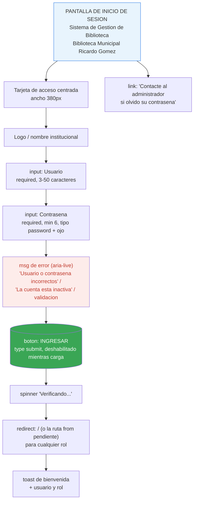

**Campos**

| Campo | Tipo | Obligatorio | Validación cliente | Validación servidor (Zod `loginSchema`) |
|---|---|---|---|---|
| `username` | text | Sí | `required`, sin espacios al borde | `z.string().min(3).max(50)` |
| `password` | password | Sí | `required` | `z.string().min(6).max(100)` |

| **Flujo:** el formulario se envía con `POST /api/auth/login`. En 400 se pinta `BAD_REQUEST` con `details` (`campo: mensaje` vía `errorMessage`); en 401 se muestra el mensaje genérico "Usuario o contraseña incorrectos" junto al bloque de errores; en 403 "La cuenta está inactiva. Contacta al administrador"; en 429 `RATE_LIMITED` "Demasiados intentos de inicio de sesión". El botón permanece deshabilitado con spinner durante la petición (RU-05). Con 200 se guarda el token, se llama `GET /api/auth/me` y se navega a `/` (o a la ruta `from` que originó el login) — todas las rutas se filtran después por rol en el menú (RU-07).

---

## 2. Dashboard / pantalla principal (`/`)

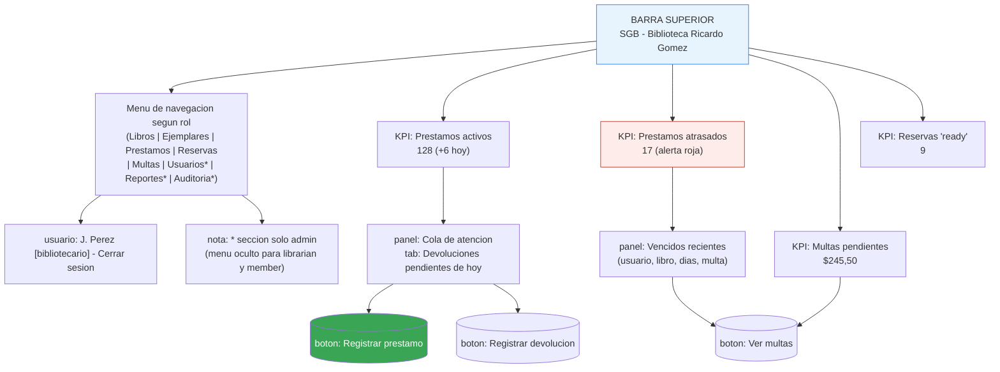

**Contenido y comportamiento**

- Cuatro KPI obtenidos de `GET /api/reports/summary`; los atrasados se pintan en rojo cuando > 0 (RU-12).
- Panel de cola con las devoluciones del día y accesos directos a "Registrar préstamo" y "Registrar devolución" (RU-01: tarea < 45 s).
- Menú **condicionado por rol** (RU-07): `member` solo ve Catálogo, Mis préstamos, Mis reservas y Mis multas; `librarian` no ve Usuarios ni Auditoría; `admin` ve todo.
- Si el token expira, cualquier carga redirige a `/login` con el aviso "Sesión expirada" (RU-11).

---

## 3. Gestión de libros — CRUD (`/libros`)

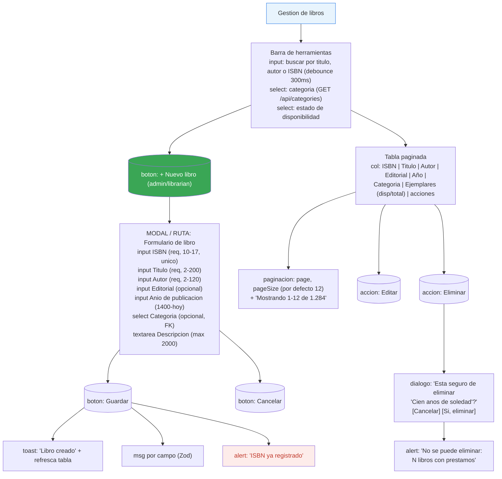

**Campos y validaciones (esquema `createBookSchema`)**

| Campo | Zod (`bookSchema`) | Notas |
|---|---|---|
| `isbn` | `z.string().min(10).max(17).regex(/^[0-9X-]+$/)`, unico | RF-16 → 409 `CONFLICT` |
| `title` | `z.string().min(2).max(200)` | — |
| `author` | `z.string().min(2).max(120)` | — |
| `publisher` | `z.string().max(120).nullish()` | — |
| `publicationYear` | `z.number().int().min(1400).max(añoActual+1).nullish()` | CHECK en BD |
| `categoryId` | `z.number().int().positive().nullish()` | FK → 400 si la categoría no existe |
| `description` | `z.string().max(2000).nullish()` | — |

**Flujo:** búsqueda y filtro disparan `GET /api/books?search=&categoryId=&available=&page=&pageSize=`; al abrir la ficha se muestra un **modal de ejemplares** (`GET /api/books/:id/copies`) con su estado. Eliminar exige confirmación nombrando el recurso (RU-04) y responde 422 `BUSINESS_RULE_VIOLATION` si algún ejemplar tiene préstamo activo.

---

## 4. Gestión de ejemplares (`/libros` → modal "Ejemplares")

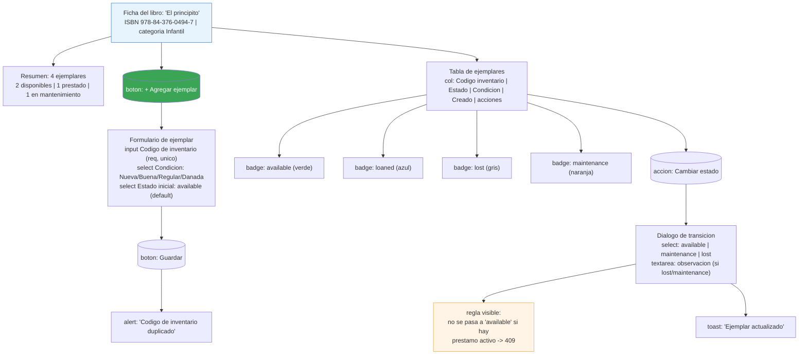

**Campos y validaciones**

| Campo | Zod (`copySchema`) | Regla de negocio |
|---|---|---|
| `inventoryCode` | `z.string().min(3).max(40).regex(/^[A-Za-z0-9._-]+$/)` + unico | RF-20 → 409 duplicado |
| `condition` | enum `good\|regular\|damaged` (default `good`) | Informativo |
| `status` (solo en `PUT`) | enum `available\|loaned\|lost\|maintenance` | RF-21: la transición a `available` está bloqueada si existe préstamo activo (422); `lost`/`maintenance` sacan el ejemplar del préstamo. |

**Flujo:** se accede desde la ficha del libro; cada cambio llama `PUT /api/copies/:id` y refresca contadores del libro. Las acciones destructivas (marcar `lost`) piden confirmación con el código del ejemplar.

---

## 5. Registrar préstamo (`/prestamos` — sección "Registrar préstamo")

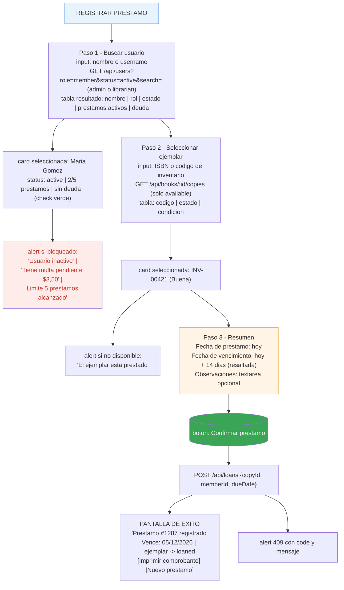

**Validaciones**

- **Cliente:** los dos pasos deben tener selección antes de habilitar "Confirmar"; se muestra la fecha de vencimiento calculada (RU-10).
- **Servidor (`createLoanSchema`):** `copyId` y `memberId` enteros positivos, `dueDate` opcional (`YYYY-MM-DD`, debe ser futura); luego el servicio aplica RF-24…RF-31 en este orden: ejemplar `available` → usuario `active` → sin multas `pending` → menos de 5 préstamos activos. Cada rechazo se pinta en la alerta correspondiente con su `code` (422 `BUSINESS_RULE_VIOLATION`).
- **Flujo alternativo:** si el usuario tiene deuda, la alerta incluye el botón "Ver multas" para que el bibliotecario pueda registrar el pago antes de prestar (RF-48).

---

## 6. Devolución (`/prestamos` — botón "Registrar devolución" por fila)

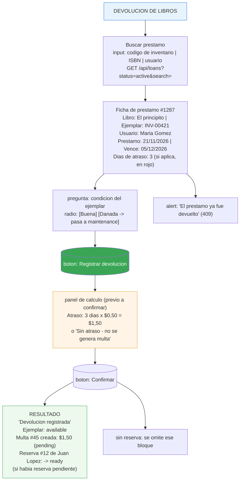

**Validaciones y reglas**

- Se busca por `GET /api/loans?status=active&search=…`; solo aparecen préstamos activos.
- El servidor calcula `días_atraso = max(0, date(return_date) − date(due_date))` y la multa `× 0,50` (RF-31) **en la capa de servicios**, no en el cliente.
- Si hay reserva `pending` del libro, la respuesta informa que pasó a `ready` (RF-32).
- Estado del ejemplar: `available` por defecto; si se marca "Dañada" pasa a `maintenance` y no vuelve a estar prestable hasta que un administrador lo libere (RF-30).

---

## 7. Lista de préstamos (`/prestamos`)

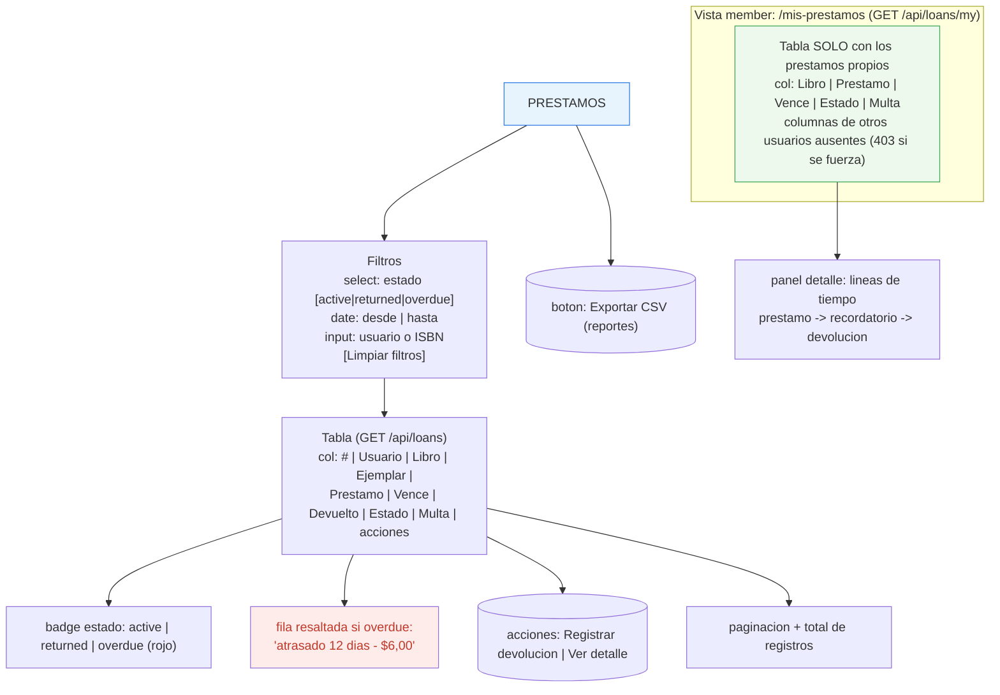

**Comportamiento**

- `GET /api/loans?status=&search=&overdue=&memberId=` (RF-33), respuesta enriquecida con datos de usuario, libro y ejemplar por JOIN en el repositorio. El listado no pagina: devuelve el conjunto filtrado con `meta.total`.
- El endpoint `GET /api/loans/my` (RF-34) filtra siempre por `user_id = token.id`; además, para un `member` el propio `GET /api/loans` fuerza ese filtro y `GET /api/loans/:id` devuelve 403 sobre préstamos ajenos (RS-11, ERR-10).
- Los préstamos `overdue` se recalculan al listar (RF-35) y muestran días de atraso y multa estimada.
- Los filtros de texto se limitan a 120 caracteres y los listados devuelven `meta.total` (RR-08).

---

## 8. Reservas (`/reservas`)

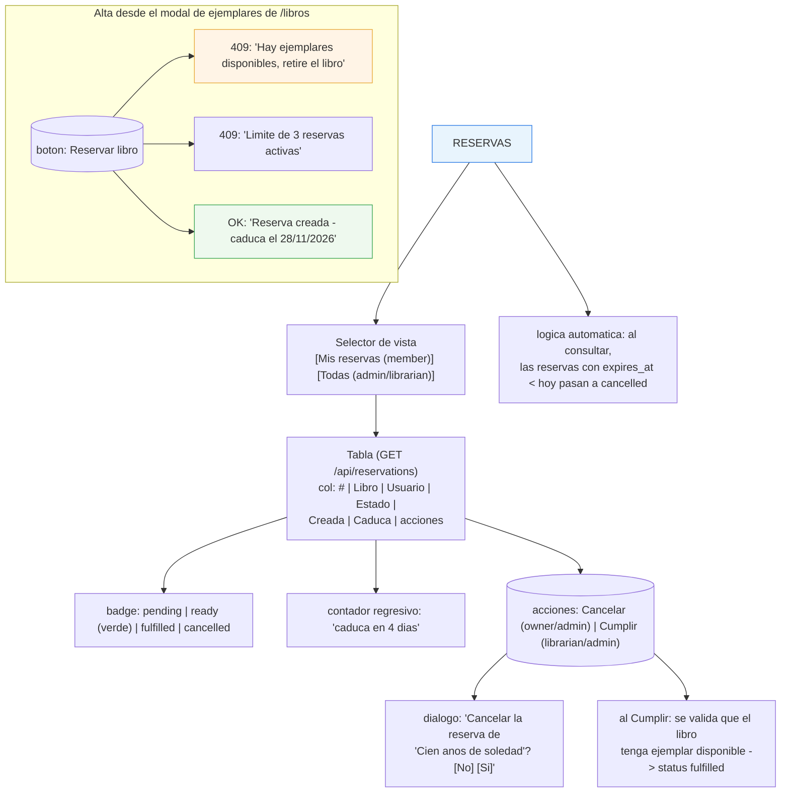

**Campos y validaciones**

| Campo | Origen | Regla |
|---|---|---|
| `book_id` | ficha del libro | Todos sus ejemplares deben estar `loaned` (RF-37) |
| `user_id` | token JWT (no se acepta del body) | Máx. 3 activas (RF-38) |
| `expires_at` | servidor: `now + 7 días` | RF-39; no editable por el cliente |

**Flujo:** el miembro reserva desde la ficha; el bibliotecario ve la cola, y al devolver un libro el sistema marca la reserva más antigua como `ready`; "Cumplir" cierra la reserva al entregar el ejemplar (RF-42). Cancelar exige confirmación (RU-04) y solo es permitido al dueño o a roles superiores (RS-11).

---

## 9. Gestión de usuarios (`/usuarios`) — solo admin

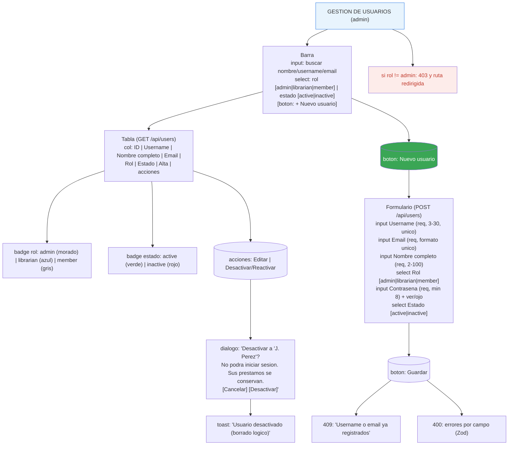

**Validaciones (esquema `createUserSchema`)**

| Campo | Zod | Extra |
|---|---|---|
| `username` | `z.string().min(3).max(30).regex(/^[a-zA-Z0-9._-]+$/)` | único → 409 |
| `email` | `z.string().email()` | único → 409 |
| `full_name` | `z.string().min(2).max(100)` | — |
| `role` | `z.enum(['admin','librarian','member'])` | solo admin puede asignar `admin` |
| `password` | `z.string().min(8).max(72)` | hash bcrypt 12 antes de persistir; **nunca** se devuelve |
| `status` | `z.enum(['active','inactive'])` | default `active` |

**Flujo:** desactivar es **borrado lógico** (RF-10) con diálogo de confirmación; el usuario inactivo no puede loguearse (RF-03) pero conserva su histórico. Ningún endpoint de esta pantalla está disponible para `librarian`/`member` (RF-12 → 403).

---

## 10. Multas (`/multas` y `/mis-multas`)

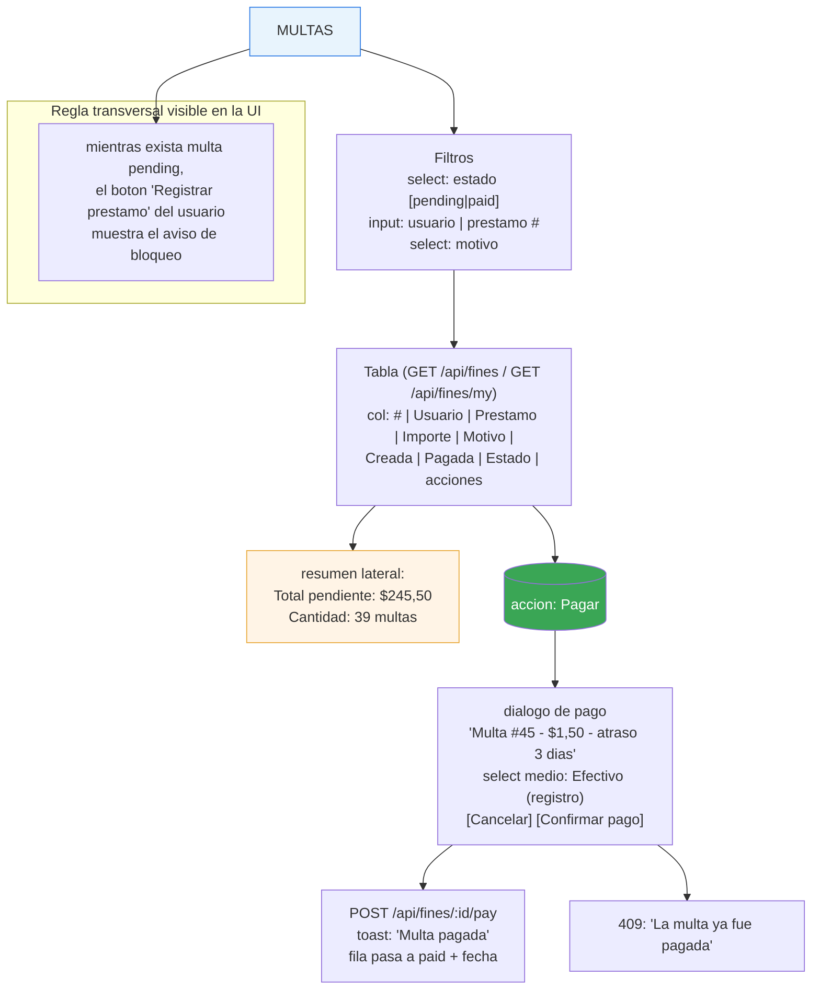

**Campos y comportamiento**

- `GET /api/fines?status=&user_id=` (admin/librarian) y `GET /api/fines/my` (member) — RF-44/RF-45.
- `POST /api/fines/:id/pay` valida con Zod `payment_method` opcional, cambia a `paid`, fija `paid_at` y escribe `FINE_PAID` en auditoría (RF-46).
- La pantalla impide el doble pago (botón deshabilitado si `status='paid'` + 409 de respaldo, RF-47).
- El miembro ve únicamente sus multas; forzar otro `user_id` devuelve 403/404 (RS-11).
- El importe mostrado siempre incluye el desglose `días × 0,50` tomado del `reason` persistido.

---

## 11. Reportes y consultas (`/reportes`)

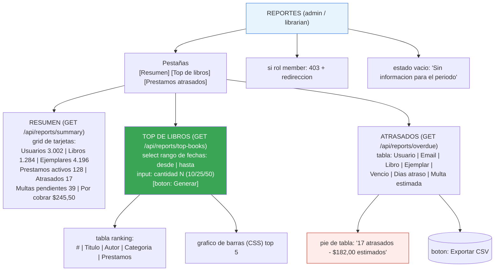

**Parámetros y validaciones**

| Endpoint | Query | Validación |
|---|---|---|
| `GET /api/reports/summary` | — | Solo `admin`/`librarian` (RF-52) |
| `GET /api/reports/top-books` | `date_from`, `date_to`, `limit` | Fechas ISO, `date_from ≤ date_to` (400 si invertidas), `limit ≤ 100` |
| `GET /api/reports/overdue` | — | Calcula días de atraso con la fecha local del servidor |

**Flujo:** el usuario elige pestaña → el frontend llama al endpoint → muestra tabla y KPIs; si no hay datos se muestra el estado vacío (RU-02). La exportación CSV se genera en cliente a partir de los datos ya recibidos, sin un endpoint adicional.

---

## 12. Auditoría (`/auditoria`) — solo admin

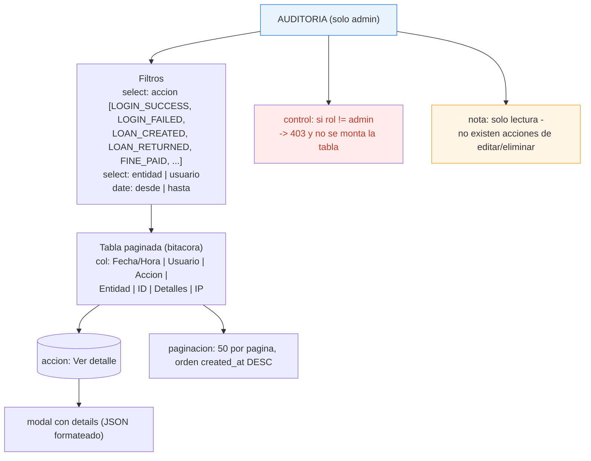

**Comportamiento:** consulta de solo lectura sobre `audit_logs` ordenada por `created_at` descendente con filtros por acción, entidad y usuario (RF-54). La interfaz **no** ofrece edición ni borrado porque la tabla es *append-only* (RF-55). El `details` se muestra formateado en un modal para no saturar la tabla.

---

## 13. Mapa de navegación general

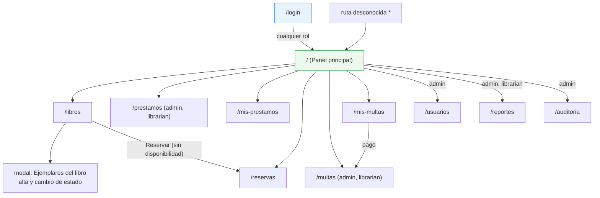

### Resumen de rutas y guardas

| Ruta | Página React | Guarda de rol |
|---|---|---|
| `/login` | `LoginPage` | pública (con `from` para volver tras autenticar) |
| `/` | `DashboardPage` | autenticado |
| `/libros` | `BooksPage` (catálogo + modal de ejemplares + reserva) | autenticado (lectura); alta/edición solo `staff` |
| `/prestamos` | `LoansPage` (alta, listado con filtros y devolución) | `admin`, `librarian` |
| `/mis-prestamos` | `LoansPage` (`GET /api/loans/my`) | autenticado (el socio solo ve los suyos) |
| `/reservas` | `ReservationsPage` (crear/cancelar propias; personal ve y cumple todas) | autenticado |
| `/multas` | `FinesPage` (`GET /api/fines` con filtro) | `admin`, `librarian` |
| `/mis-multas` | `FinesPage` (`GET /api/fines/my` + pago) | autenticado |
| `/usuarios` | `UsersPage` | `admin` |
| `/reportes` | `ReportsPage` | `admin`, `librarian` |
| `/auditoria` | `AuditPage` | `admin` |
| `*` | redirige a `/` | — |

Todas las rutas protegidas están envueltas en `ProtectedRoute`. Ante **falta de sesión** redirige a `/login` conservando la ruta original en `state.from`; ante **rol no autorizado** no navega: muestra el mensaje "No tienes permisos para acceder a esta sección (rol requerido: …)" dentro de la ruta (RU-07). Si el servidor responde 401, el cliente limpia el token y el siguiente movimiento del usuario lo devuelve al login con aviso de sesión expirada (RU-11). El menú lateral (`Layout`) oculta las entradas que el rol no puede usar.
