# 8. Evidencias de pruebas

**Asignatura:** Ingeniería de Software II
**Proyecto:** Sistema de Gestión de Biblioteca (SGB) — Biblioteca Pública Municipal "Ricardo Gómez"
**Tipo de artefacto:** Evidencia de verificación (registros, reportes y capturas)
**Fecha de la corrida:** 25 de noviembre de 2026
**Estado:** ✅ todas las verificaciones en verde

---

## 8.1. Metadatos de la corrida

| Aspecto | Valor |
|---|---|
| Fecha y hora (UTC) | 2026-11-25T20:57:20Z |
| Commit base | `c47e56b` — *feat(database): scripts SQL ejecutables (DDL y consultas por modulo)* |
| Rama | `dev` |
| Sistema operativo | Microsoft Windows 11 Home |
| Node.js | v22.13.1 |
| Motor de pruebas | Vitest 2.1.9 + supertest 7 |
| Cobertura | `@vitest/coverage-v8` 2.1.9 (V8) |
| Capturas | Playwright 1.65 + Chromium (build completa, `--lang=es-ES`) |
| Resumen de resultados | **96/96 pruebas** · **16/16 pasos de humo** · `tsc` exit 0 · build OK · cobertura **88,53 %** (stmts) |

---

## 8.2. Qué contiene esta sección

Las evidencias se publican en [`docs/evidencias/`](evidencias/) con tres tipos de material:

| Tipo | Ubicación | Descripción |
|---|---|---|
| **Registros crudos** | [`evidencias/registros/`](evidencias/registros/) | Salidas literales (UTF-8, sin códigos ANSI) de los seis comandos de verificación. |
| **Reportes estructurados** | [`evidencias/reportes/`](evidencias/reportes/) | `suite.json` (reporte JSON de Vitest) y `cobertura/` (reporte HTML navegable por archivo). |
| **Capturas de pantalla** | [`evidencias/capturas/`](evidencias/capturas/) | 16 PNG generados automáticamente con Playwright, con nombre descriptivo de lo que muestran. |

**Índice de evidencias ↔ trazabilidad**

| # | Evidencia | Tipo | Requisitos / casos de uso |
|---|---|---|---|
| 1 | `registros/tsc-tipos-backend.log` | Registro | RS (tipos estrictos) · verificación de cierre |
| 2 | `registros/suite-96-pruebas.log` | Registro | 96 casos de `docs/10-pruebas.md` §3 |
| 3 | `registros/coverage-reporte.log` | Registro | Cobertura planeada ≥ 80 % (`10-pruebas.md` §4) |
| 4 | `registros/build-frontend.log` | Registro | Compilación de producción del SPA |
| 5 | `registros/smoke-16-pasos.log` | Registro | Flujo extremo a extremo (16 pasos) |
| 6 | `reportes/suite.json` | Reporte | 96 tests, 0 fallidos (lectura máquina) |
| 7 | `reportes/cobertura/` (HTML) | Reporte | Cobertura por archivo y línea |
| 8 | `capturas/login-pantalla-inicio-sesion.png` | Captura | RF-01 · CU-01 |
| 9 | `capturas/dashboard-admin-kpis.png` | Captura | RF-49 · CU-13 |
| 10 | `capturas/catalogo-libros-busqueda-filtros.png` | Captura | RF-17 · CU-06 |
| 11 | `capturas/prestamos-lista-gestion-devolucion.png` | Captura | RF-33 · CU-08 |
| 12 | `capturas/prestamo-formulario-registro.png` | Captura | RF-23 · CU-07 |
| 13 | `capturas/reservas-lista-estados.png` | Captura | RF-40 · CU-11 |
| 14 | `capturas/multas-lista-pago.png` | Captura | RF-44 · RF-46 · CU-12 |
| 15 | `capturas/usuarios-lista-alta-edicion.png` | Captura | RF-06 · CU-02 |
| 16 | `capturas/validacion-formulario-campos-invalidos.png` | Captura | RS-04 (validación en cliente) |
| 17 | `capturas/validacion-servidor-error-zod.png` | Captura | RS-04 · RF-07 (validación en servidor) |
| 18 | `capturas/reportes-ranking-vencidos-mensual.png` | Captura | RF-50 · RF-51 · CU-13 |
| 19 | `capturas/auditoria-bitacora-eventos.png` | Captura | RF-53 · RF-54 · CU-14 |
| 20 | `capturas/socio-mis-prestamos.png` | Captura | RF-34 · CU-16 |
| 21 | `capturas/socio-mis-multas.png` | Captura | RF-45 · CU-12 |
| 22 | `capturas/error-403-socio-acceso-prohibido.png` | Captura | RF-12 (RBAC) |
| 23 | `capturas/reporte-cobertura-pruebas-html.png` | Captura | Reporte de cobertura (visual) |

---

## 8.3. Registros de ejecución

Se transcriben las salidas completas (o las líneas principales, cuando el registro es extenso). Los archivos originales están en [`evidencias/registros/`](evidencias/registros/).

### 8.3.1 Verificación de tipos del backend

`evidencias/registros/tsc-tipos-backend.log`

```text
$ cd server && npx tsc -p tsconfig.json --noEmit
# 2026-11-25T20:57:20.421Z

(sin salida de errores — la verificación de tipos pasó)

[exit code 0]
```

### 8.3.2 Suite automatizada (96 pruebas)

`evidencias/registros/suite-96-pruebas.log` — **8 archivos, 96 pruebas, 0 fallos**:

```text
$ cd server && npm test
# 2026-11-25T20:57:20.421Z

 RUN  v2.1.9 C:/Users/Atom X/biblioteca/server

 ✓ tests/reports.test.ts (8 tests) 913ms
 ✓ tests/fines.test.ts (9 tests) 979ms
 ✓ tests/books.test.ts (15 tests) 1301ms
 ✓ tests/loans.test.ts (14 tests) 1687ms
 ✓ tests/reservations.test.ts (12 tests) 1899ms
 ✓ tests/auth.test.ts (12 tests) 2976ms
 ✓ tests/categories.test.ts (10 tests) 849ms
 ✓ tests/users.test.ts (16 tests) 6813ms

 Test Files  8 passed (8)
      Tests  96 passed (96)
   Duration  12.93s

[exit code 0]
```

Caso representativo de cada área (extraído del registro completo):

```text
 ✓ POST /api/loans      > FC-PRE-01: el bibliotecario registra un préstamo y el ejemplar pasa a prestado
 ✓ Gestión de reservas  > FC-RES-12: al devolver un libro con reserva, la reserva pasa a "ready"
 ✓ POST /api/auth/login > FC-AU-01: autentica a un administrador con credenciales válidas
 ✓ POST /api/auth/register > FC-AU-10: el administrador crea un socio y puede iniciar sesión
 ✓ GET /api/users       > RB-USR-01: un bibliotecario no puede consultar el padrón de usuarios
 ✓ POST /api/users      > FC-USR-05: crea un usuario bibliotecario
 ✓ PUT /api/users/:id   > FC-USR-09: actualiza la contraseña con validación de fortaleza
 ✓ GET /api/fines       > MUL-02: el socio ve solo sus multas y el total pendiente
 ✓ GET /api/books       > FC-CAT-01: lista el catálogo con paginación y totales
```

### 8.3.3 Prueba de humo (16 pasos)

`evidencias/registros/smoke-16-pasos.log` — extremo a extremo contra la API real:

```text
$ cd server && node scripts/smoke.mjs
# 2026-11-25T20:57:20.421Z

=== Prueba de humo · Sistema de Gestión de Biblioteca ===

  ✓ GET /api/health — status=up
  ✓ Login de administrador — rol=admin
  ✓ Login de bibliotecario — rol=librarian
  ✓ Login de socio — rol=member
  ✓ Rechazo de contraseña inválida — 401 correcto
  ✓ Consulta del catálogo (socio) — 1 resultado(s)
  ✓ Reserva de un libro sin disponibilidad — "El principito" → pending
  ✓ Reserva duplicada rechazada (409) — 409 correcto
  ✓ Registro de préstamo (bibliotecario) — préstamo #12, vence 2026-12-09
  ✓ Préstamo duplicado rechazado (422) — 422 correcto
  ✓ Socio no puede registrar préstamos (403) — 403 correcto
  ✓ Devolución del préstamo — estado=returned, multa=0
  ✓ Reporte de resumen (admin) — libros=12, activos=4, vencidos=2
  ✓ Auditoría registrada (admin) — 10 eventos recientes
  ✓ Socio sin acceso a auditoría (403) — 403 correcto
  ✓ Cancelación de reserva — estado=cancelled

Resultado: 16/16 pasos correctos.

[exit code 0]
```

### 8.3.4 Compilación del frontend

`evidencias/registros/build-frontend.log` (`tsc --noEmit && vite build`):

```text
$ cd client && npm run build
# 2026-11-25T20:57:20.421Z

✓ 2180 modules transformed.
rendering chunks...
computing gzip size...
dist/index.html                   0.66 kB │ gzip:  0.38 kB
dist/assets/index-Chr-ySyq.css    8.12 kB │ gzip:  2.41 kB
dist/assets/index-CIWNWGtP.js   223.67 kB │ gzip: 68.57 kB
✓ built in 7.23s

[exit code 0]
```

### 8.3.5 Cobertura (resumen)

`evidencias/registros/coverage-reporte.log` — tabla resumen (el reporte completo, archivo por archivo, está en [`evidencias/reportes/cobertura/`](evidencias/reportes/cobertura/)):

```text
-------------------|---------|----------|---------|---------|
File               | % Stmts | % Branch | % Funcs | % Lines |
-------------------|---------|----------|---------|---------|
All files          |   88.53 |    74.86 |   87.42 |   88.53 |
 src               |     100 |       50 |     100 |     100 |
 src/config        |     100 |       25 |     100 |     100 |
 src/db            |   83.87 |    57.14 |     100 |   83.87 |
 src/errors        |     100 |      100 |     100 |     100 |
 src/middleware    |   76.11 |    75.67 |      90 |   76.11 |
 src/modules/audit |      90 |    33.33 |     100 |      90 |
 src/modules/auth  |    98.7 |    75.86 |     100 |    98.7 |
 src/modules/books |   77.83 |    76.92 |   74.19 |   77.83 |
 ...les/categories |   80.57 |       85 |   76.47 |   80.57 |
 ...modules/copies |   70.73 |      100 |       0 |   70.73 |
 src/modules/fines |     100 |    82.14 |     100 |     100 |
 src/modules/loans |   96.12 |    72.54 |     100 |   96.12 |
 ...odules/reports |     100 |    84.61 |     100 |     100 |
 ...s/reservations |   86.46 |       80 |      90 |   86.46 |
 src/modules/users |   93.58 |    73.68 |   95.65 |   93.58 |
-------------------|---------|----------|---------|---------|
```

**Lectura del resultado:** la cobertura global de sentencias (**88,53 %**) supera la meta planeada de ≥ 80 % en servicios (`docs/10-pruebas.md` §4). Los módulos de negocio críticos se comportan como se esperaba: `fines` y `reports` al **100 %**, `loans` al **96,12 %** y `auth` al **98,7 %**. Los porcentajes menores se concentran en ramas de manejo de errores (`errorHandler.ts`) y en `copies` (controller cubierto vía otros módulos), cuyos casos están detallados en `10-pruebas.md` §4.3.

---

## 8.4. Reportes estructurados

| Reporte | Contenido |
|---|---|
| [`evidencias/reportes/suite.json`](evidencias/reportes/suite.json) | Reporte JSON de Vitest: **33 suites · 96 tests · 0 fallidos · 0 pendientes**, con duración por archivo y por caso. Pensado para lectura por máquina (CI, analizadores). |
| [`evidencias/reportes/cobertura/`](evidencias/reportes/cobertura/index.html) | Reporte HTML de cobertura (70 archivos): porcentaje por archivo y **líneas sin cubrir** señaladas. Abrir `index.html` en un navegador. |

---

## 8.5. Capturas de pantalla

Generadas automáticamente por [`client/scripts/capturas.mjs`](../client/scripts/capturas.mjs) (Playwright, Chromium headless, 1440×900 @2x, idioma `es-ES`). Cada archivo lleva un **nombre descriptivo de lo que muestra**.

### 8.5.1 Autenticación y panel

**`login-pantalla-inicio-sesion.png`** — Pantalla de acceso sin sesión activa (RF-01 · CU-01).

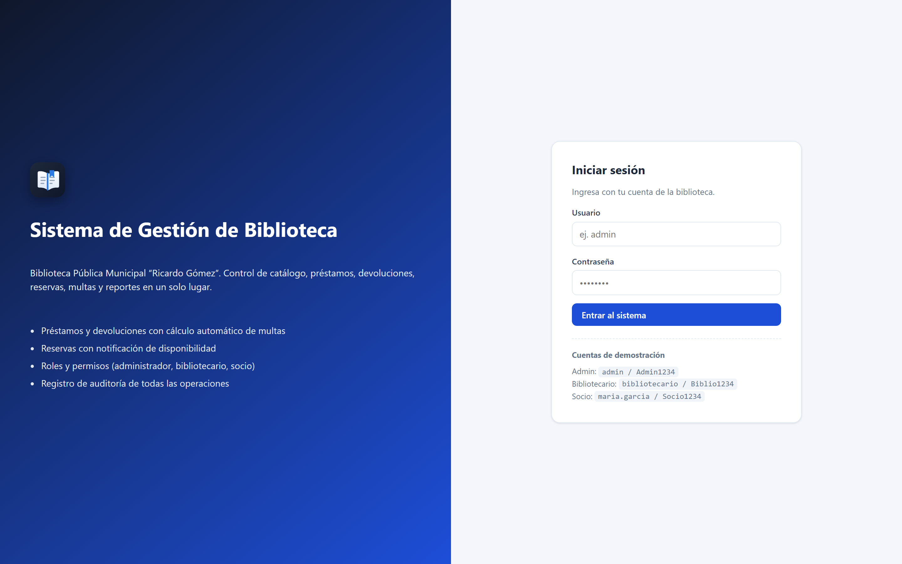

**`dashboard-admin-kpis.png`** — Panel del administrador con los KPIs del reporte de resumen: usuarios, libros, ejemplares, préstamos activos y vencidos (RF-49 · CU-13).

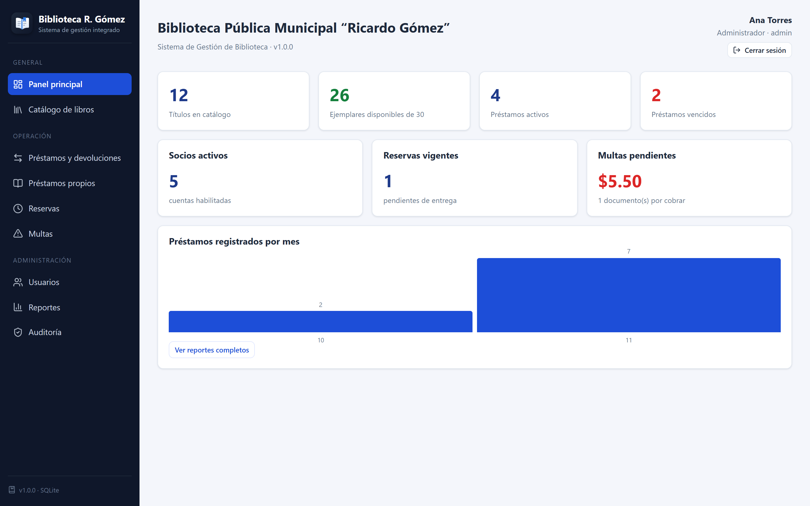

### 8.5.2 Catálogo y préstamos

**`catalogo-libros-busqueda-filtros.png`** — Catálogo con búsqueda por autor aplicada en vivo y filtros por categoría (RF-17 · CU-06).

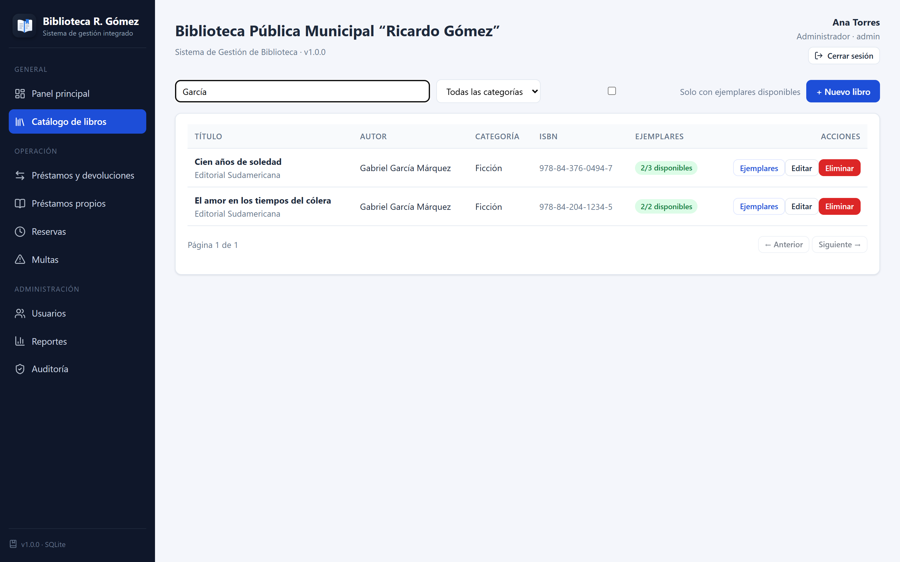

**`prestamos-lista-gestion-devolucion.png`** — Lista de préstamos con filtros por estado y acciones de gestión/devolución (RF-33 · CU-08).

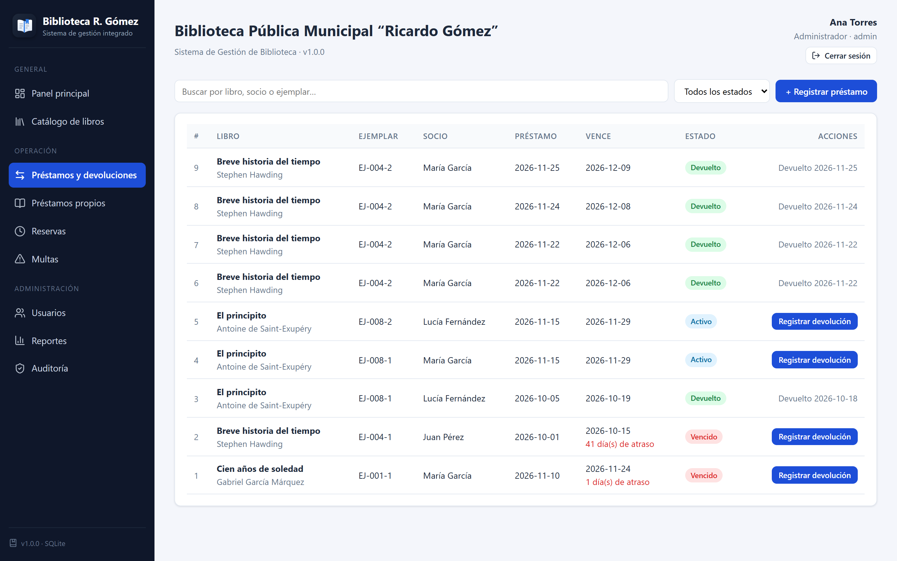

**`prestamo-formulario-registro.png`** — Formulario modal de registro de préstamo con selección de socio, ejemplar y fecha de vencimiento (RF-23 · CU-07).

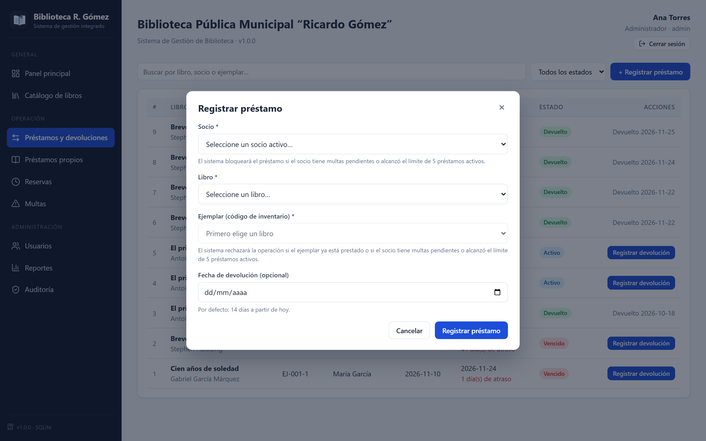

### 8.5.3 Reservas y multas

**`reservas-lista-estados.png`** — Lista de reservas con sus estados (`pending`, `ready`, `fulfilled`, `cancelled`) (RF-40 · CU-11).

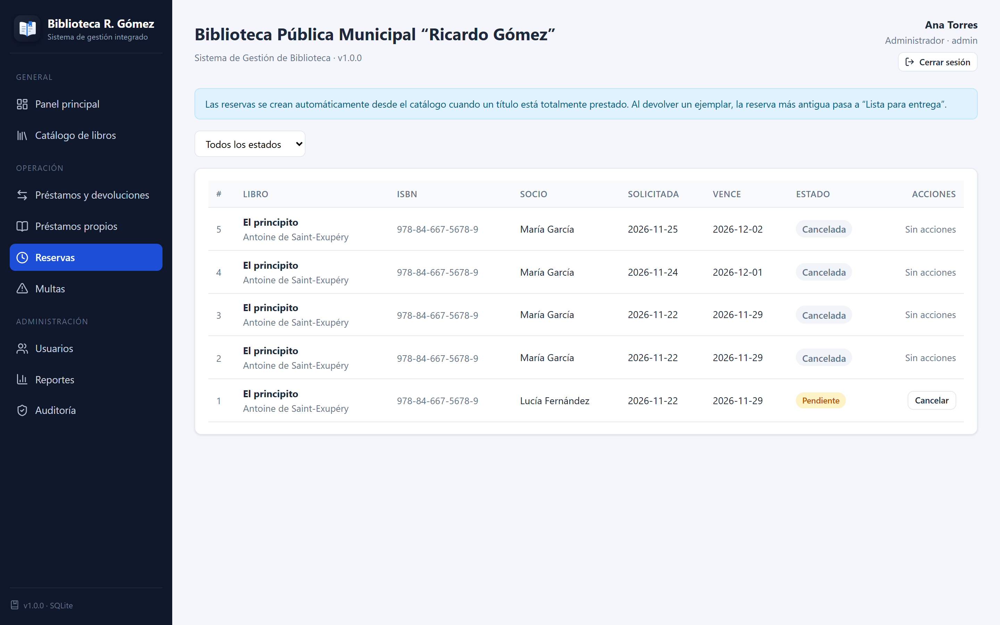

**`multas-lista-pago.png`** — Multas con importe, motivo, estado y acción de pago (RF-44 · RF-46 · CU-12).

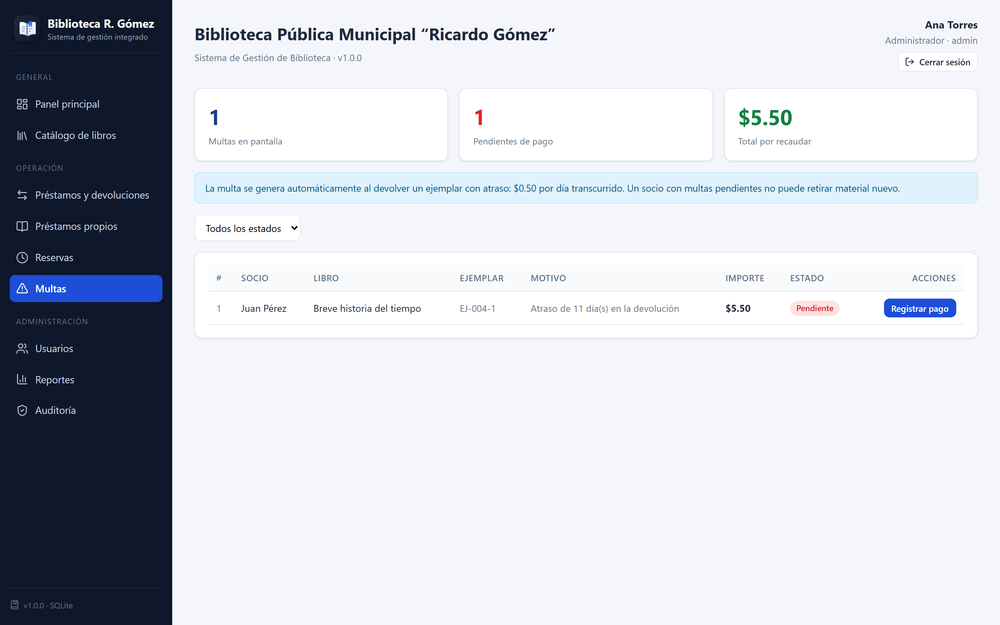

**`socio-mis-multas.png`** — Vista del socio: solo sus multas con el total pendiente (RF-45 · CU-12).

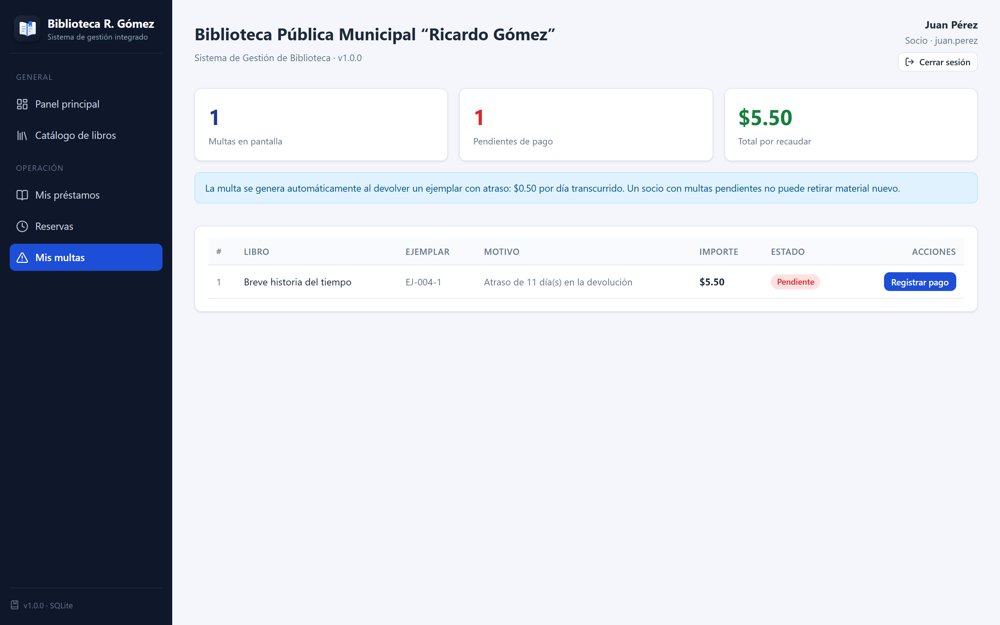

### 8.5.4 Usuarios y validación

**`usuarios-lista-alta-edicion.png`** — Padrón de usuarios con búsqueda, filtro por rol y alta/edición (RF-06 · CU-02).

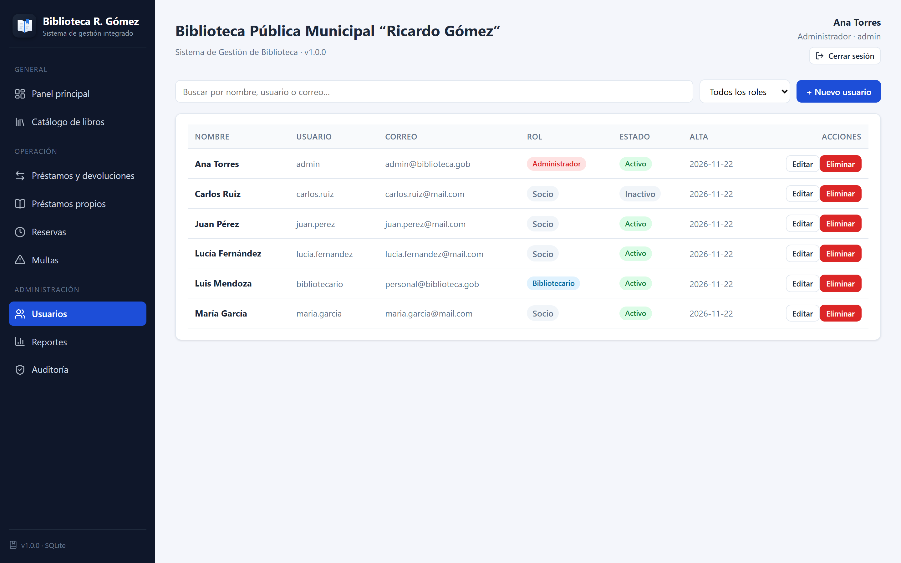

**`validacion-formulario-campos-invalidos.png`** — Validación **en cliente**: burbuja nativa (HTML5 `minLength`) en español al crear un usuario con contraseña corta (RS-04).

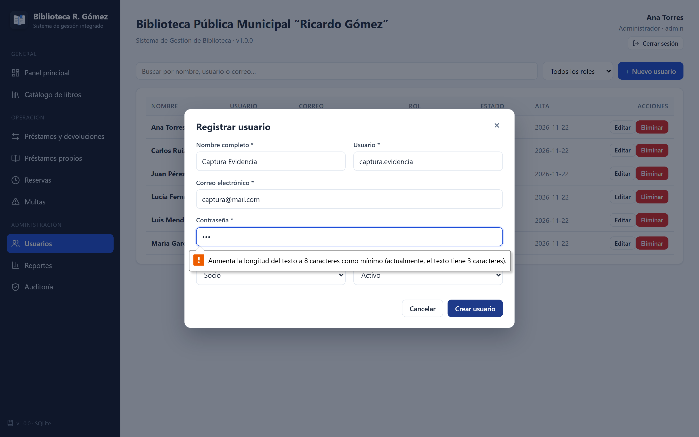

**`validacion-servidor-error-zod.png`** — Validación **en servidor**: rechazo 400 con el detalle del esquema Zod en español («la contraseña debe contener al menos una mayúscula y un número») (RS-04 · RF-07).

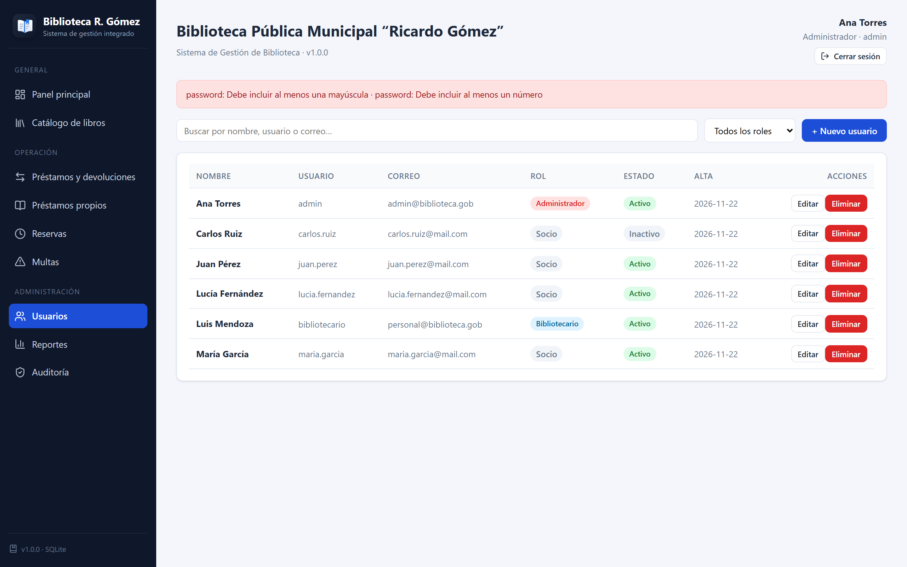

### 8.5.5 Reportes y auditoría

**`reportes-ranking-vencidos-mensual.png`** — Reportes: ranking de libros más prestados, préstamos vencidos y serie mensual (RF-50 · RF-51 · CU-13).

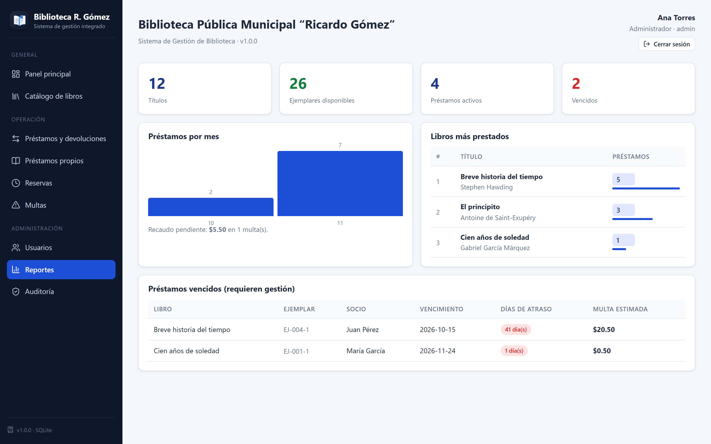

**`auditoria-bitacora-eventos.png`** — Bitácora de auditoría con acción, usuario, IP y fecha (RF-53 · RF-54 · CU-14).

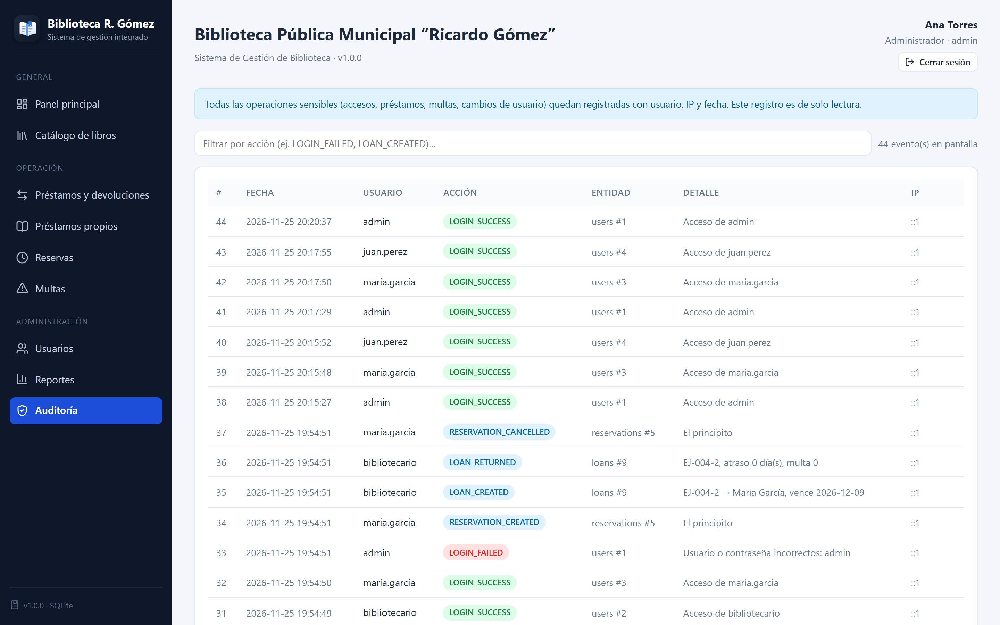

### 8.5.6 Sesión de socio y control de acceso

**`socio-mis-prestamos.png`** — Vista del socio: únicamente sus propios préstamos (RF-34 · CU-16).

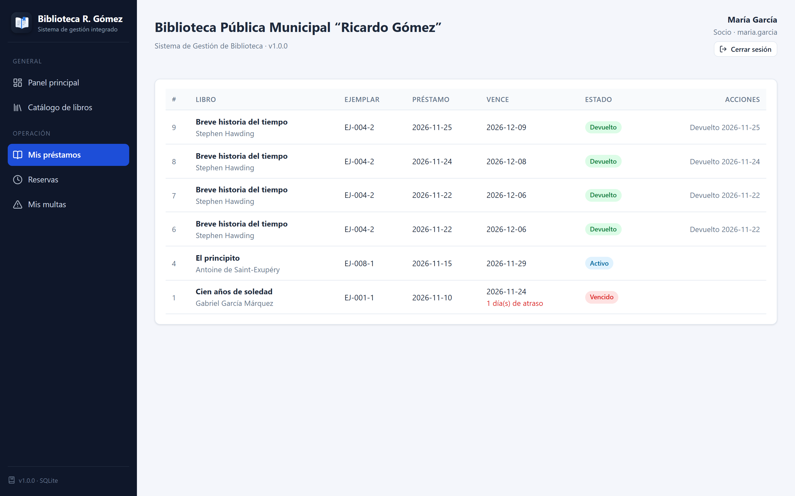

**`error-403-socio-acceso-prohibido.png`** — Acceso denegado: un socio que navega a `/usuarios` recibe el aviso de permisos requeridos (RF-12 · RBAC) (verificación manual complementaria a `RB-USR-01`).

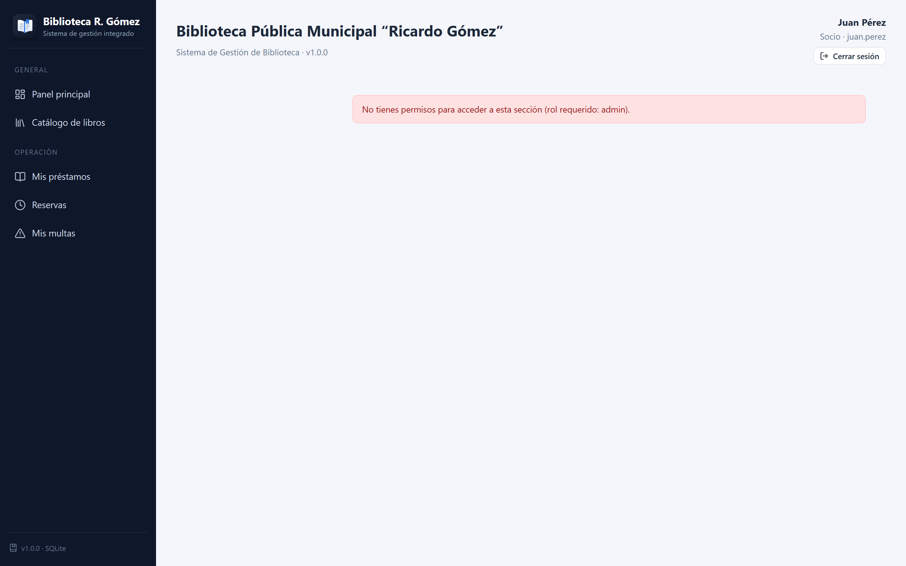

### 8.5.7 Reporte de cobertura

**`reporte-cobertura-pruebas-html.png`** — Reporte HTML de cobertura abierto en el navegador (88,53 % stmts / 74,86 % branch / 87,42 % funcs).

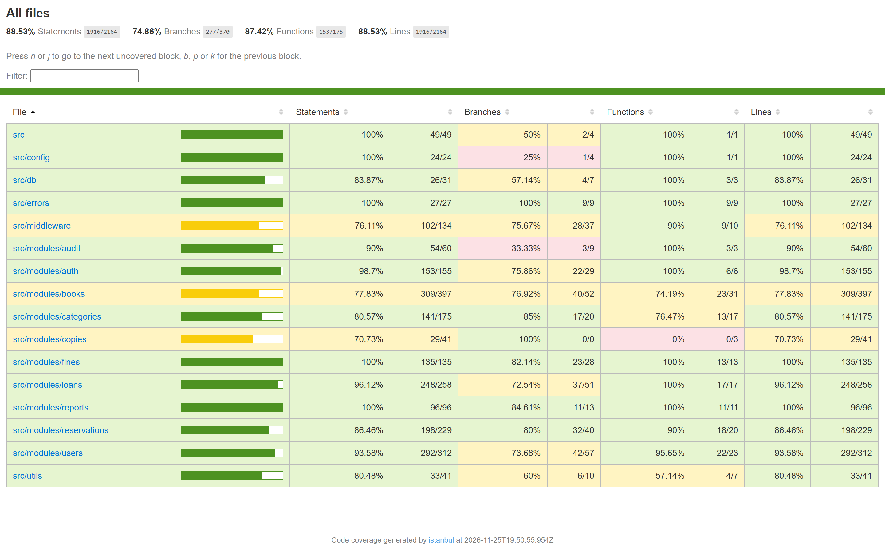

---

## 8.6. Cómo regenerar las evidencias

Toda esta sección es **reproducible** desde la raíz del repositorio:

```bash
# 1 · Regenera registros + reportes (tsc, suite, cobertura, JSON, build, smoke)
node scripts/regenerar-evidencias.mjs

# 2 · Regenera las 16 capturas (levanta API y frontend si hace falta
#     y detiene únicamente los servicios que él mismo inició)
node client/scripts/capturas.mjs
```

Notas de regeneración:

- Los logs se producen **desde Node** (no desde PowerShell) para garantizar UTF-8 con acentos y glifos `✓`; además se elimina cualquier código ANSI.
- La prueba de humo requiere la API en el puerto 4000; el script la levanta automáticamente si no está corriendo.
- Las capturas requieren datos de demostración: `cd server && npm run seed` (si la base ya contiene datos, el seed no se re-ejecuta; para partir de cero, borrar `server/data/` y volver a sembrar).
- El reporte de cobertura se genera con `npm run coverage` en `server/` y se copia a `evidencias/reportes/cobertura/`.

---

## 8.7. Alcance y limitaciones de la evidencia

| Aspecto | Detalle |
|---|---|
| Casos automatizados | 96 de 96 en verde (`10-pruebas.md` §3). |
| Casos **no** automatizados | RF-19, RF-21, RF-25, RF-35, RF-38, RF-39, RF-43 y RF-55 (ver `10-pruebas.md` §7): requieren cron jobs, datos de larga duración o rejillas de seguridad; se verifican por inspección y por los flujos de humo. |
| Cobertura | 88,53 % stmts / 74,86 % branch / 87,42 % funcs / 88,53 % lines — meta ≥ 80 % cumplida. |
| Capturas | 16 PNG (~4,7 MB) generados con Playwright; el navegador y los selectores quedan fijados en `client/scripts/capturas.mjs`, de modo que cualquier cambio visual detectable rompe la regeneración y obliga a actualizar esta sección. |
| Datos | Las capturas y el humo usan la base sembrada de demostración; los identificadores de préstamos y multas pueden variar entre corridas (p. ej. «préstamo #11»). |

---

**Volver al índice:** [`docs/README.md`](README.md) · **Ver también:** [`10-pruebas.md`](10-pruebas.md) (estrategia, catálogo de casos y registro de errores) · [`12-gestion.md`](12-gestion.md) (trazabilidad RF → endpoint → prueba).
