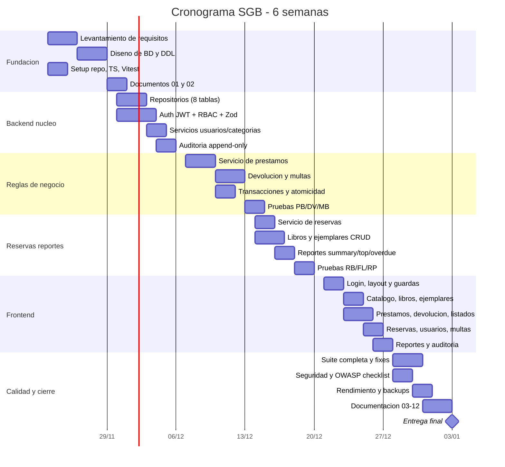

# 12 — Gestión del proyecto

**Proyecto:** Sistema de Gestión de Biblioteca (SGB)
**Documento:** Metodología, cronograma, herramientas, control de versiones, gestión de incidencias y trazabilidad requisitos → implementación.

---

## 1. Metodología — Scrum adaptado a trabajo individual

Se adopta un **Scrum simplificado (adaptado a un único desarrollador)**: se conservan los artefactos y las ceremonias útiles y se elimina toda la coordinación de equipo que no aplica a un trabajo final individual.

| Elemento Scrum | Versión adaptada al SGB |
|---|---|
| **Product Owner** | El propio estudiante, actuando en representación de la Biblioteca "Ricardo Gómez" (prioriza según los RF y las necesidades de la dirección). |
| **Scrum Master** | El propio estudiante (auto-gestión, retiro de impedimentos: dudas técnicas, configuración, errores). |
| **Equipo de desarrollo** | 1 desarrollador (trabajo final individual). |
| **Product Backlog** | Lista priorizada de RF-01…RF-55 + RNF + documentación, en formato de tareas con ID, estimación y estado. |
| **Sprint** | **1 semana** (6 sprints en 6 semanas). |
| **Sprint Backlog** | Subconjunto de RF y tareas comprometidas en la semana, con checklist de "hecho" (compila + pruebas + documentado). |
| **Incremento** | Versión funcional y compilable al final de cada sprint (`main` siempre en estado ejecutable). |
| **Daily** | Auto-revisión diaria de 5 min: qué avancé, qué bloquea, qué sigue (apuntes en `progress.md` del planificador). |
| **Sprint Review** | Demo funcional al cierre de cada semana: recorrer los RF terminados y actualizar la tabla de trazabilidad. |
| **Retroalimentación (Retrospectiva)** | 15 min al final del sprint: qué salió bien, qué mejorar (herramientas, orden de tareas, errores recurrentes). |
| **Definition of Done (DoD)** | 1) código implementado; 2) `tsc --noEmit` sin errores; 3) pruebas del módulo en verde; 4) RF trazado; 5) documentación actualizada; 6) commit convencional. |

**Reglas de planificación:** cada sprint debe dejar el sistema **compilable y con las pruebas en verde**; si una tarea se desborda, se re-planifica en el siguiente sprint (no se amplía la semana). El orden de construcción sigue la dependencia de datos: BD → repositorios → servicios → API → frontend → reportes → pulido y pruebas.

---

## 2. Cronograma general (6 semanas)

| Semana | Sprint | Actividades principales | RF entregados | Artefactos de la semana |
|---|---|---|---|---|
| **S1** | Sprint 1 — Fundación | Levantamiento de requisitos con la biblioteca; definición de reglas de negocio; diseño de la BD (entidades, 3FN, DDL); inicialización del repositorio Git; estructura del monorepo (`client/`, `server/`, `docs/`); configuración de TypeScript, ESLint, Vitest. | — (base) | `01-problema.md`, `02-requisitos.md`, script DDL, esqueleto compilable |
| **S2** | Sprint 2 — Núcleo del dominio | Capa de repositorios (CRUD 8 tablas); servicios de catálogo y usuarios; esquemas Zod; **autenticación JWT + bcrypt + RBAC**; middleware `authenticate/authorize/validate`; registro de auditoría. | RF-01…RF-15, RF-53…RF-55 | API de auth, usuarios y categorías operativas; pruebas IN-01…IN-06, FU-xx, FC-xx |
| **S3** | Sprint 3 — Préstamos y multas | Servicio de préstamos con las 5 reglas de negocio; devolución con cálculo de atraso y multa; límite de 5 activos; bloqueo por deuda; transacciones; endpoints de préstamos y multas. | RF-23…RF-36, RF-44…RF-48 | Ciclo préstamo→devolución→multa completo; pruebas PB-xx, DV-xx, MB-xx; registro de ERR-01…ERR-04 |
| **S4** | Sprint 4 — Reservas, catálogo completo y reportes | Servicio de reservas (disponibilidad, límite 3, caducidad 7 días, activación al devolver); CRUD de libros y ejemplares con búsqueda/paginación; reportes (summary, top-books, overdue). | RF-16…RF-22, RF-37…RF-43, RF-49…RF-52 | API completa (34 endpoints); pruebas RB-xx, FL-xx, FE-xx, RP-xx |
| **S5** | Sprint 5 — Frontend completo | SPA React: login, dashboard con KPIs, catálogo, CRUD libros/ejemplares, registrar préstamo, devolución, listados con filtros, reservas, usuarios, multas, reportes, auditoría; guardas por rol; validación espejo. | RU-01…RU-12 (UI de todos los RF) | 11 pantallas navegables; `07-interfaces.md` final; pruebas FF-01…FF-08 |
| **S6** | Sprint 6 — Calidad, seguridad y cierre | Suite completa de pruebas y corrección de errores; seguridad (helmet, rate limit, OWASP checklist); pruebas de rendimiento; copias de seguridad; redacción final de la documentación (03, 04, 05, 06, 08, 10, 11, 12); retrospectiva y entrega. | Cierre de RNF/RS/RD/RR | Documentación completa, `10-pruebas.md`, `11-calidad.md`, entrega final |

**Hitos (milestones):**

| Hito | Fecha objetivo (semana) | Criterio de aceptación |
|---|---|---|
| H1 — Requisitos aprobados | Fin de S1 | Documentos 01 y 02 revisados, 55 RF priorizados |
| H2 — API autenticada funcional | Fin de S2 | Login + RBAC + usuarios/categorías con pruebas en verde |
| H3 — Ciclo de préstamo operativo | Fin de S3 | Prueba E2E API: préstamo → devolución → multa correcta |
| H4 — API completa | Fin de S4 | 34 endpoints responden según contrato |
| H5 — Sistema navegable | Fin de S5 | 11 pantallas con rol adecuado |
| H6 — Entrega final | Fin de S6 | Documentación 01–12 + suite verde + checklist de calidad |

---

## 3. Diagrama de Gantt



### Explicación del Gantt

El diagrama muestra las seis semanas con sus tareas solapadas dentro de cada sprint, respetando la **dependencia técnica**: no hay tareas de frontend antes de existir una API autenticada (fin de S2), y las pruebas de cada módulo se ejecutan cuando el módulo está implementado. Los solapes deliberados (por ejemplo, repositorios y autenticación en la misma semana) indican actividades que pueden avanzarse en paralelo dentro del sprint, mientras que las dependencias encadenadas (`after`) protegen el orden crítico: BD → servicios → reglas de negocio → UI → calidad.

El hito final (`milestone` del 03/01/2027) marca la entrega del entregable completo: documentación 01–12, suite de pruebas en verde y checklist de calidad firmado. Se eligió un Gantt en Mermaid porque permite mantener el cronograma **dentro del propio repositorio documental** y actualizarlo en cada retrospectiva sin herramientas externas.

---

## 4. Herramientas

| Área | Herramienta | Uso |
|---|---|---|
| Lenguajes | TypeScript 5 (strict) | Frontend y backend |
| Backend | Node.js 22, Express 4 | API REST |
| Validación | Zod | Esquemas compartidos |
| Seguridad | jsonwebtoken, bcryptjs, helmet, express-rate-limit, cors | Auth, hash, cabeceras, límite, CORS |
| Base de datos | SQLite + better-sqlite3 | Persistencia, WAL, FK |
| Frontend | React 18, Vite, react-router-dom | SPA |
| Pruebas | Vitest, supertest | Unitarias, integración, E2E API |
| Control de versiones | Git + GitHub | Historial y respaldo |
| Commits | Conventional Commits | Historial legible y semántico |
| Gestión de tareas | Tablero (GitHub Projects / tablas Markdown en `12-gestion.md`) | Sprint backlog y estado |
| Planificación | Skill de planificación con archivos (`task_plan.md`, `progress.md`) | Seguimiento diario |
| Documentación | Markdown + Mermaid | Los 12 documentos de `docs/` |
| Análisis estático | `tsc --noEmit`, ESLint, `npm audit` | Calidad y seguridad |
| Copias de seguridad | `sqlite3 .backup` / `VACUUM INTO` | Backup diario |

---

## 5. Control de versiones

### 5.1 Estrategia de ramas

```
main ──●──●──●──●──●──●──●──●──  (siempre compilable, historia lineal)
        \        /
         feature/loans   ← rama temporal de tarea (opcional, se fusiona con --no-ff)
```

| Regla | Detalle |
|---|---|
| **Rama principal** | `main` única y permanente; **no** se rompe: solo se integra con la suite verde y `tsc` limpio |
| **Ramas de feature** | Opcionales para tareas > 1 día (`feature/loans`, `feature/reservations`); se fusionan al terminar y se eliminan |
| **No se usa Git Flow completo** | `develop`, `release/*` y `hotfix/*` se descartan por ser un proyecto individual (decisión AD-10, doc. 05) |
| **Tamaño de commit** | Atómico: una idea o un RF por commit |
| **Antes de cada commit** | `tsc --noEmit` + suite rápida del módulo + revisión del diff |
| **Etiquetas** | `v0.1.0` (S2, API auth), `v0.5.0` (S4, API completa), `v1.0.0` (S6, entrega) |
| **Respaldo** | El repositorio en GitHub actúa como respaldo remoto del código (no de la BD) |

### 5.2 Commits convencionales

Formato: `tipo(ambito): descripción en imperativo, sin punto final`.

| Tipo | Uso | Ejemplo |
|---|---|---|
| `feat` | Nueva funcionalidad / RF | `feat(loans): registrar prestamo con plazo de 14 dias` |
| `fix` | Corrección de error | `fix(multas): usar fecha local en el calculo de atraso (ERR-01)` |
| `test` | Pruebas | `test(loans): casos PB-01 a PB-06 con supertest` |
| `docs` | Documentación | `docs(requisitos): agregar RNF-15 y matriz de trazabilidad` |
| `refactor` | Cambio sin alterar comportamiento | `refactor(repositories): consultas parametrizadas (ERR-04)` |
| `chore` | Infraestructura/configuración | `chore(vite): habilitar build de produccion` |
| `security` | Cambio de seguridad | `security(auth): rate limit de 10 intentos en login` |
| `perf` | Rendimiento | `perf(books): indice compuesto para busqueda por titulo` |
| `style` | Formato sin lógica | `style(eslint): corregir advertencias` |

**Alcance recomendado:** `auth`, `users`, `categories`, `books`, `copies`, `loans`, `reservations`, `fines`, `reports`, `audit`, `ui`, `db`, `pruebas`, `docs`, `config`.

**Ejemplos de historia de commits (una semana tipo):**

```
chore(scaffold): inicializar monorepo client/server con TypeScript
docs(requisitos): redactar RF-01 a RF-55 con verificacion
feat(auth): login con JWT y bloqueo de usuarios inactivos
feat(users): CRUD con RBAC exclusivo de administrador
test(auth): casos IN-01 a IN-06 con supertest
fix(auth): mensaje generico en credenciales invalidas (ERR-03)
```

---

## 6. Gestión de incidencias

### 6.1 Flujo

```
Detección → Registro (ERR-nn) → Clasificación (severidad) → Asignación (sprint)
   → Corrección → Regresión (prueba que lo cubre) → Verificación → Cierre
```

| Severidad | Definición | Tiempo objetivo | Respuesta |
|---|---|---|---|
| **Crítica** | Pérdida de datos, fallo de seguridad explotable o bloqueo total | Se resuelve en el mismo sprint | Bloquea el avance; se ataca primero |
| **Alta** | Regla de negocio incorrecta o fuga de información | ≤ 1 sprint | Entra al sprint actual |
| **Media** | Comportamiento incorrecto con alternativa | ≤ 2 sprints | Planificada |
| **Baja** | Estética o mejora menor | Backlog | Se evalúa en retrospectiva |

### 6.2 Registro y tablero

- Cada incidencia recibe ID `ERR-nn` y se registra en la tabla de `10-pruebas.md` §4 con descripción, severidad, caso de prueba, corrección y estado.
- El tablero de sprint tiene columnas: `Por hacer` → `En curso` → `En revisión` → `Hecho`.
- **Regla:** ninguna incidencia se cierra sin una **prueba de regresión** asociada (nuevo caso o ampliación de uno existente).
- Los errores ya detectados y corregidos en este proyecto (ERR-01…ERR-08) se detallan en el documento de pruebas; ninguno quedó abierto al cierre.

### 6.3 Riesgos del proyecto y respuesta

| ID | Riesgo | Prob. | Impacto | Respuesta |
|---|---|---|---|---|
| RS-P1 | Subestimar el esfuerzo del frontend | Alta | Alto | Priorizar pantallas críticas (login, catálogo, préstamo, devolución) en S5 temprano; resto como pulido |
| RS-P2 | Errores de cálculo de fechas/multas | Media | Alto | Reloj inyectable + pruebas UN-01…UN-04 con casos límite (ERR-01) |
| RS-P3 | Perder tiempo por errores de entorno (npm/build) | Media | Medio | Bloquear instalación en S1; lockfile; documentar comandos en README |
| RS-P4 | Alcance desbordado (funciones extra) | Alta | Medio | Lista explícita de "fuera de alcance" (doc. 01 §8); toda adición negocia un RF |
| RS-P5 | Caída del equipo local sin respaldo | Baja | Crítico | Git diario + backup semanal de la BD |
| RS-P6 | Deuda técnica acumulada | Media | Medio | Retrospectiva semanal con métricas (doc. 11); refactors dentro del sprint |

---

## 7. Trazabilidad requisitos → implementación

### 7.1 Autenticación y usuarios

| RF | Descripción corta | Endpoint(s) | Módulo implementador | Prueba |
|---|---|---|---|---|
| RF-01 | Login con JWT | `POST /api/auth/login` | `AuthController`, `AuthService` | IN-01 |
| RF-02 | Credenciales inválidas | `POST /api/auth/login` | `AuthService` | IN-02 |
| RF-03 | Bloqueo de inactivos | `POST /api/auth/login` | `AuthService` | IN-04 |
| RF-04 | Usuario del token | `GET /api/auth/me` | `AuthController` | IN-03 |
| RF-05 | Auditoría de login | interno | `AuditService` | AU-01 |
| RF-06 | Listar usuarios | `GET /api/users` | `UserController`, `UserService` | FU-01 |
| RF-07 | Crear usuario | `POST /api/users` | `UserService` | FU-02 |
| RF-08 | Username/email únicos | `POST /api/users` | `UserService` | FU-03 |
| RF-09 | Editar usuario | `PUT /api/users/:id` | `UserService` | FU-05 |
| RF-10 | Borrado lógico | `DELETE /api/users/:id` | `UserService` | FU-04 |
| RF-11 | Registro solo admin | `POST /api/auth/register` | `AuthController` + `authorize('admin')` | FU-05 |
| RF-12 | `member` sin acceso a usuarios | `/api/users/*` | `authorize('admin')` | SE-01 |

### 7.2 Catálogo

| RF | Descripción corta | Endpoint(s) | Módulo implementador | Prueba |
|---|---|---|---|---|
| RF-13 | CRUD categorías | `GET/POST /api/categories`, `PUT/DELETE /api/categories/:id` | `CategoryService` | FC-01, FC-02 |
| RF-14 | Baja bloqueada con libros | `DELETE /api/categories/:id` | `CategoryService` | FC-03 |
| RF-15 | CRUD libros | `POST/PUT /api/books` | `BookService` | FL-01, FL-02 |
| RF-16 | ISBN único | `POST /api/books` | `BookService` | FL-03 |
| RF-17 | Búsqueda + filtro + paginación | `GET /api/books` | `BookRepository` | FL-04, FL-05 |
| RF-18 | Contadores de ejemplares | `GET /api/books` | `BookRepository` (JOIN) | FL-06 |
| RF-19 | Baja condicionada | `DELETE /api/books/:id` | `BookService` | FL-07 |
| RF-20 | Alta de ejemplares | `POST /api/books/:id/copies` | `CopyService` | FE-01, FE-02 |
| RF-21 | Estado de ejemplar | `PUT /api/copies/:id` | `CopyService` | FE-03 |
| RF-22 | Ficha con ejemplares | `GET /api/books/:id/copies` | `CopyRepository` | FE-03 |

### 7.3 Préstamos y devoluciones

| RF | Descripción corta | Endpoint(s) | Módulo implementador | Prueba |
|---|---|---|---|---|
| RF-23 | Préstamo con vencimiento +14 | `POST /api/loans` | `LoanService` | PB-01, UN-01 |
| RF-24 | Solo ejemplares `available` | `POST /api/loans` | `LoanService` | PB-02 |
| RF-25 | Usuario activo | `POST /api/loans` | `LoanService` | PB-03 |
| RF-26 | Sin deuda pendiente | `POST /api/loans` | `LoanService` | PB-04 |
| RF-27 | Límite de 5 activos | `POST /api/loans` | `LoanService` | PB-05, UN-06 |
| RF-28 | Ejemplar → `loaned` + auditoría | `POST /api/loans` | `LoanService` (transacción) | PB-06 |
| RF-29 | Devolución con fecha | `POST /api/loans/:id/return` | `LoanService` | DV-01 |
| RF-30 | Ejemplar → `available` | `POST /api/loans/:id/return` | `LoanService` | DV-01 |
| RF-31 | Multa 0,50/día | `POST /api/loans/:id/return` | `LoanService` + `FineService` | DV-02, UN-04 |
| RF-32 | Reserva → `ready` | `POST /api/loans/:id/return` | `ReservationService` | DV-03 |
| RF-33 | Listado con filtros | `GET /api/loans` | `LoanRepository` | PL-01 |
| RF-34 | Mis préstamos | `GET /api/loans/my` | `LoanController` | PL-02 |
| RF-35 | Marcaje `overdue` | `GET /api/loans` | `LoanService` | PL-03 |
| RF-36 | Doble devolución bloqueada | `POST /api/loans/:id/return` | `LoanService` | DV-04 |

### 7.4 Reservas, multas, reportes y auditoría

| RF | Descripción corta | Endpoint(s) | Módulo implementador | Prueba |
|---|---|---|---|---|
| RF-37 | Reserva sin disponibilidad | `POST /api/reservations` | `ReservationService` | RB-01, RB-02 |
| RF-38 | Límite 3 activas | `POST /api/reservations` | `ReservationService` | RB-03 |
| RF-39 | Caducidad 7 días | `POST /api/reservations` | `ReservationService` | RB-01, UN-11 |
| RF-40 | Listado de reservas | `GET /api/reservations` | `ReservationController` | RB-04 |
| RF-41 | Cancelar reserva | `POST /api/reservations/:id/cancel` | `ReservationService` | RB-04, RB-05 |
| RF-42 | Cumplir reserva | `POST /api/reservations/:id/fulfill` | `ReservationService` | RB-06 |
| RF-43 | Caducidad diferida | `GET /api/reservations` | `ReservationService` | RB-07 |
| RF-44 | Multas globales | `GET /api/fines` | `FineController` | MB-01 |
| RF-45 | Mis multas | `GET /api/fines/my` | `FineController` | MB-02 |
| RF-46 | Pago de multa | `POST /api/fines/:id/pay` | `FineService` | MB-03 |
| RF-47 | Doble pago bloqueado | `POST /api/fines/:id/pay` | `FineService` | MB-04 |
| RF-48 | Deuda bloquea préstamo | `POST /api/loans` | `LoanService` | MB-05 |
| RF-49 | Resumen | `GET /api/reports/summary` | `ReportService` | RP-01 |
| RF-50 | Top de libros | `GET /api/reports/top-books` | `ReportService` | RP-02 |
| RF-51 | Atrasados | `GET /api/reports/overdue` | `ReportService` | RP-03 |
| RF-52 | Reportes restringidos | `/api/reports/*` | `authorize('admin','librarian')` | SE-03 |
| RF-53 | Auditoría de acciones | interno | `AuditService` | AU-01 |
| RF-54 | Bitácora solo admin | `GET /api/audit` | `authorize('admin')` | AU-02 |
| RF-55 | Bitácora append-only | sin endpoints de escritura | `AuditRepository` | AU-03 |

### 7.5 Requisitos no funcionales → evidencia

| Rango | Dónde se implementa | Dónde se verifica |
|---|---|---|
| RNF-01…RNF-06, RNF-15 | índices, paginación, bcrypt 12, WAL | Pruebas RR-01…RR-05 (doc. 10) |
| RNF-07, RNF-08 | DDL con FK/CHECK, transacciones | BD-01…BD-04 |
| RNF-09 | SQLite local, sin dependencias externas | Revisión de arquitectura (doc. 05) |
| RNF-10, RNF-11 | Vitest + `tsc --noEmit` | Reportes de cobertura y typecheck |
| RNF-12 | Documentación `docs/` 01–12 | Este entregable |
| RNF-13, RNF-14 | Vite build, CSS responsive | FF-01…FF-08 y revisión visual |
| RS-01…RS-12 | middlewares, bcrypt, Zod, helmet, rate limit | Casos SE-01…SE-10 (doc. 10) |
| RD-01…RD-07 | WAL, backups, `errorHandler` | Doc. 08 §10 y checklist |
| RU-01…RU-12 | UI React, mensajes, confirmaciones | Casos FF-01…FF-08 |

**Cobertura de la trazabilidad:** 55/55 RF con endpoint, módulo y caso de prueba asignados → **100 %**.
